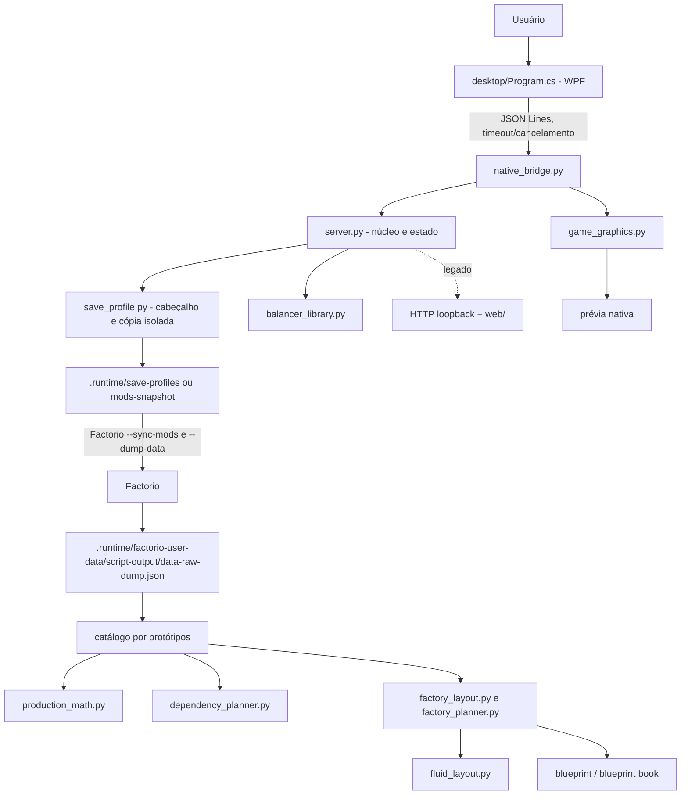

# Revisão da arquitetura

## Visão geral

ForgePlan é um aplicativo local Windows com WPF/C# e motor Python. A interface inicia um processo Python persistente e troca mensagens JSON Lines. O processo local coordena o executável Factorio, mantém estado/cache e monta catálogo, plano e blueprint. game_graphics.py lê assets locais para a prévia 2.5D. O README informa que o app não abre navegador nem servidor HTTP no caminho desktop.

## Mapa de componentes

## Fluxo real de dados

1. Interface enumera executável, mods e saves do usuário. Seleção de save lê apenas cabeçalho e lista de mods do level-init.dat.
2. Perfil de save copia os mods compatíveis a uma pasta isolada. Perfil de mods ativos tira snapshot local.
3. Factorio executa sync-mods para save selecionado e --dump-data contra o diretório isolado/ativo. O app lê o dump serializado final dos protótipos.
4. Catálogo filtra receitas hidden/sem produto e ordena pelo grupo, subgrupo e ordem dos protótipos. Não cruza progresso de tecnologia do mundo.
5. O planner calcula produção para uma receita, deriva a cadeia para fins de resumo, prepara equipamento/módulos e monta entidades/logística.
6. String JSON é comprimida e codificada. Livro reúne strings unitárias concluídas. A prévia consome os mesmos dados de entidades e sprites.

## Dependências e abstrações

| Componente | Responsabilidade efetiva | Fronteira |
|---|---|---|
| desktop/Program.cs | Estado da UI, entrada, seleção, cancelamento, exportação | Processo Python pelo protocolo JSON Lines |
| native_bridge.py | Adapta comandos de UI para funções do motor; busca sprites | server.py e GameGraphics |
| server.py | Descoberta/configuração, Factorio/Ollama, catálogo, cálculo, HTTP antigo, serialização | Módulos de planner e biblioteca padrão |
| save_profile.py | Lê header de ZIP e copia mods ao perfil isolado | Factorio faz sincronização/carga efetiva |
| production_math.py | Compatibilidade de módulos, efeitos e capacidade de inseridor/esteira | Recebe protótipos crus |
| dependency_planner.py | Estimativa recursiva por receita | Não posiciona cadeia na planta |
| factory_layout.py | Opções, seleção de equipamento, combustível | factory_planner |
| factory_planner.py | Alocação, linhas/colunas, entidades, capacidade nominal | fluid_layout e protótipos |
| fluid_layout.py | Conecta pins suportados com canos | Geometria do planner |
| balancer_library.py | Catálogo e construção de módulos de splitter | Independente do blueprint principal |
| game_graphics.py | Sprites/ícones em cache local | Data e mods locais |

## Pontos fortes

- Carregamento usa Factorio para obter protótipos depois da aplicação dos mods.
- Python usa biblioteca padrão; desktop usa WPF sem pacotes externos no csproj.
- Protocolo local é simples; argumento do subprocesso é passado como lista e há timeouts.
- Há limite de tamanho HTTP, seleção de save e cópia para perfil isolado.
- Geometria ocupa tiles por protótipo e rejeita colisões antes de serializar.

## Riscos e acoplamento

- server.py mistura operações de arquivo, subprocessos, estado global, regras de produto e um HTTP server legado; 1.222 linhas.
- STATE e CATALOG_CACHE são globais e a validade do cache depende de perfil resolvido externamente.
- Há dois caminhos de execução: WPF via native_bridge.py e HTTP/web legado; alguns helpers de layout anteriores permanecem em server.py.
- Mods/saves são fronteiras de confiança; identidade parcial de conteúdo e nomes de mod sem validação de caminho.
- Dados do dump não carregam estado da partida, pesquisa ou inventário externo; a semântica de “perfil do save” é somente parcial.
- Não existe repositório Git neste checkout, o que impede auditoria de mudança, rastreio de release e confirmação de arquivos distribuídos.

## Interfaces e recuperação

O backend envia um resultado JSON por comando. A UI cancela após timeout/ação do usuário matando o processo Python e filhos. Erros de comando são convertidos a JSON e registrados em .runtime/desktop-bridge.log. O carregamento Factorio tem timeout de quatro minutos e sincronização de save até três minutos.

O fallback de IA usa o perfil determinístico quando habilitado. Essa recuperação não cobre erro de planejamento/logística. O lote captura exceção individual e mantém resultados parciais, comportamento adequado para objetivos independentes.

## Avaliação

Arquitetura adequada para aplicativo local pequeno/médio; não sustenta atualmente batch massivo ou megabase. Recomendações: definir um único caso de uso por fluxo, separar adaptadores de filesystem/Factorio, tornar perfil/cache explícito e criar teste de contrato em cada fronteira antes de extrair módulos.
