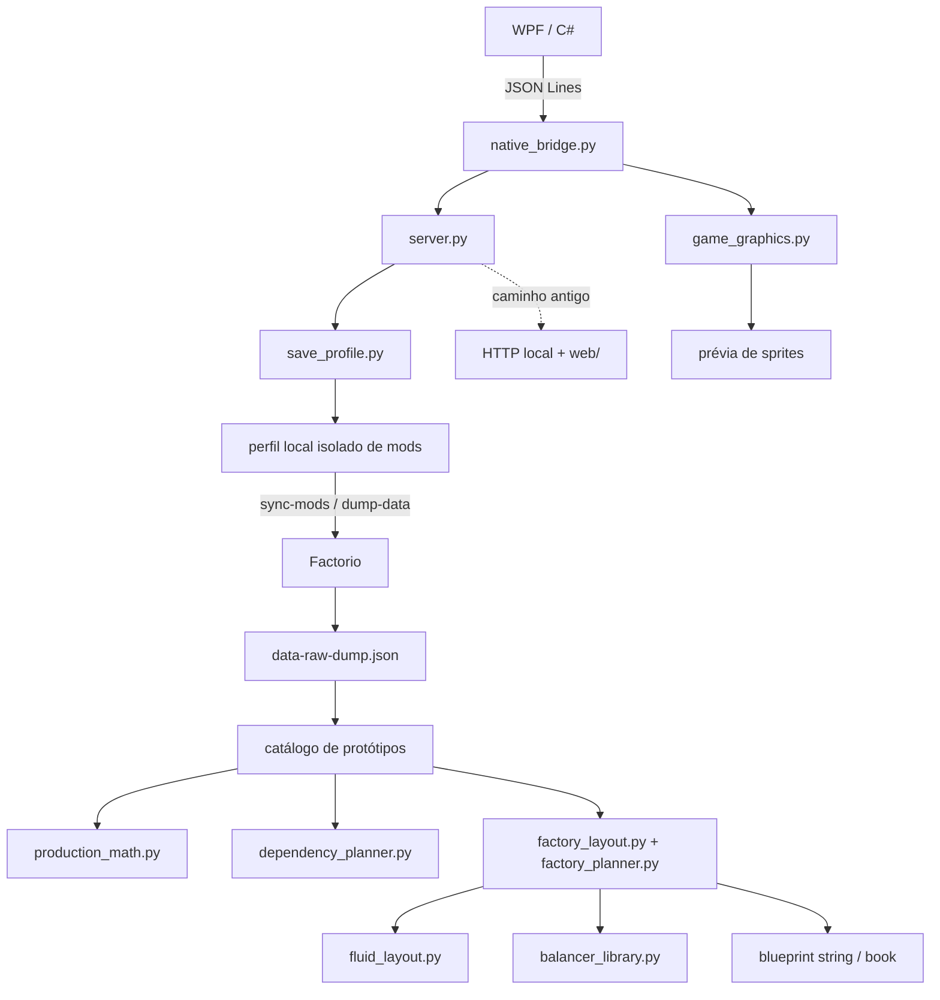

# Auditoria executiva — Factorio AI Blueprint Generator

Data: 25/10/2026  
Produto inspecionado: ForgePlan, aplicativo Windows local para planejar e exportar blueprints do Factorio.  
Escopo: auditoria somente leitura do código de produção; os únicos arquivos novos são estes relatórios.

## 1. Executive Summary

ForgePlan já tem um fluxo de produto real: interface WPF, processo Python local, carregamento de protótipos por Factorio, seleção de receita/máquina, cálculo de taxa, planejamento geométrico/logístico e exportação de blueprint string. O perfil local carregou dados de Factorio 2.1.23 com 71 mods; a suíte existente passou 44 testes.

Isso demonstra uma ferramenta funcional de planejamento e exportação. Não demonstra que o blueprint importe, seja construível ou sustente a taxa declarada no jogo. A própria descrição exportada e o README dizem que throughput e operação ainda precisam de validação. Nesta auditoria, duas strings unitárias foram descomprimidas, três blueprints independentes foram reunidos num book e vários checks estruturais passaram. Nenhum blueprint foi importado no jogo.

**Maturidade estimada: 2/5 — produto parcial, adequado para prototipagem assistida, sem evidência suficiente para uso produtivo confiável.** A avaliação não é uma média estatística. A suíte curta e a ausência de teste em jogo limitam a confiança.

### Cinco riscos mais importantes

| Prioridade | Risco | Evidência principal |
|---|---|---|
| P1 | Throughput é calculado, não simulado nem validado no Factorio | 44 testes unitários; nenhuma importação em jogo; README, linha 63 |
| P1 | Perfil Megabase não escala: cada blueprint aceita no máximo 200 máquinas e não replica blocos conectáveis | server.py, linhas 861–863; README, linhas 31 e 63 |
| P2 | Cálculo de cadeia pode duplicar insumos quando receitas compartilham coprodutos | dependency_planner.py, linhas 39–70; reprodução dinâmica |
| P2 | Alguns pedidos fluidos são rejeitados antes da exportação na configuração padrão | geração de sulfuric-acid a 100/min no perfil local |
| P2 | Nome de mod do mod-list é usado em caminhos sem validação/contenção | server.py, linhas 237–259 e 287–301 |

Não foi encontrado achado P0. Isso não significa ausência de defeitos: há lacunas de validação e riscos P1/P2 no caso central do produto.

## 2. Product Overview

Aplicativo Windows nativo em WPF/C# com motor Python local por JSON Lines. O caminho principal usa Factorio para carregar os protótipos efetivos dos mods via --dump-data. O catálogo agrupa receitas pelos grupos/subgrupos dos protótipos. A IA opcional usa Ollama em loopback e sugere apenas colunas; cálculo, layout e exportação são determinísticos.

O app produz fábricas unitárias com insumos externos e oferece lote de fábricas independentes em Blueprint Book. A análise da cadeia de receitas é separada e não transforma o lote numa fábrica integrada. A interface web preservada e o servidor HTTP Python são caminhos antigos/secundários; README identifica web como referência.

## 3. Current State Assessment

| Área | Estado real |
|---|---|
| Carregamento de protótipos | Implementado; dump local de 46,6 MB abriu; logs locais mostram Factorio inicializado |
| Produção unitária | Implementada com fórmula e arredondamento para máquinas inteiras; não validada em operação |
| Seleção múltipla | Implementada como blueprints independentes; lote local de três itens gerou book com três entradas |
| Geometria | Implementada com busca de arranjos por linhas/colunas, limites e ocupação por tiles |
| Logística por esteiras | Parcial; calcula capacidade nominal, faixas, inseridores e alguns limites; não simula fluxo sustentado |
| Fluidos | Parcial; conecta portas suportadas e aplica limite configurável; um cenário real de teste foi rejeitado |
| Balanceadores | Apenas 1→2, 2→1 e 2→2; independentes do layout e sem validação em jogo |
| Mods e saves | Integração com Factorio e leitura de cabeçalho do save; não importa estado de pesquisa do mundo |
| Blueprint | String base64/zlib decodificável; importação, construção e operação permanecem não verificadas |
| Megabase | Não implementada como sistema modular; limite de 200 máquinas por blueprint |

## 4. Executive Scorecard

| Domínio | Nota / 5 | Justificativa | Para subir um nível |
|---|---:|---|---|
| Arquitetura | 2 | Camadas separadas, mas server.py acumula catálogo, API, geração e estado global | Separar casos de uso e retirar caminho legado após testes de regressão |
| Qualidade do código | 2 | Módulos e limites existem; há duplicação/monólito e pouca validação integrada | Contratos explícitos e cobertura de falhas de ponta a ponta |
| Cálculos de produção | 2 | Fórmula-base e efeitos de módulos existem; pesquisa, qualidade e beacons ficam fora | Validar contra simulação/jogo e declarar premissas por perfil |
| Geração de blueprints | 2 | Strings decodificam e geometria tem checks; importação no jogo não ocorreu | Testes de importação e construção em ambiente descartável |
| Logística | 2 | Capacidade e faixas são planejadas; falta simulação de fluxo e bloqueios | Validar taxas sustentadas e cenários de entrada/saída parcial |
| Otimização | 2 | Perfis mudam score geométrico; busca é local à grade de linhas/colunas | Comparar candidatos por restrições e métricas operacionais |
| Compatibilidade com mods | 3 | Usa protótipos carregados pelo jogo e lê um save real; lacunas de CRC e estado do mundo | Matriz de mods/saves, versão, tecnologia e conteúdo |
| Interface | 3 | Fluxo desktop inclui seleção múltipla, equipamentos e exportação; operação visual não foi exercitada | Testes de jornada e nomes localizados |
| IA | 2 | Local e opcional, mas só sugere colunas; valor incremental não medido | Avaliação cega contra o planner determinístico |
| Performance | 2 | Uma carga local foi rápida o bastante para o ensaio; sem perfilamento nem escala | Benchmark repetível com memória de pico e vários tamanhos |
| Testes | 2 | 44 testes passam; são unitários e de fixtures | Integração, regressão de blueprint e execução no jogo |
| Segurança | 2 | Loopback, limite de corpo e timeouts; nomes de mod podem atravessar caminhos | Validar caminhos e testar arquivos malformados em sandbox |
| Escalabilidade | 1 | Limite explícito de 200 máquinas, sem replicação de blocos | Planejador incremental e geração modular sem limite artificial |
| Confiabilidade operacional | 2 | Erros e fallback existem; não há execução prolongada validada | Ensaios de cancelamento, recuperação, perfil inválido e estabilidade |
| Manutenibilidade | 2 | Sem dependências Python externas; falta metadado Git neste checkout e server.py é amplo | Repositório versionado, contratos e testes por fronteira |

## 5. Architecture Assessment

O fluxo principal usa dados efetivos de protótipos após o Factorio carregar o perfil; não lê apenas arquivos Lua de definição. Em seguida calcula uma receita por blueprint, estima dependências, escolhe máquina/módulos, planeja geometria, logística e serializa entidades. Entradas e saídas externas continuam sendo conectadas pelo jogador.

Os principais riscos arquiteturais são estado global/cache no módulo server.py, duas interfaces/caminhos de execução e responsabilidades de catálogo, processo Factorio, Ollama e exportação reunidas num arquivo de 1.222 linhas. O app WPF usa native_bridge.py; a interface web está descrita como referência, mas o servidor HTTP ainda existe.

## 6. Functional Assessment

O lote é efetivamente independente: cada objetivo chama _generate separadamente; falhas de um objetivo não cancelam os demais e os concluídos entram no livro. O ensaio local produziu 3/3 blueprints e 3 entradas no book. Não há partilha de intermediários entre objetivos.

O catálogo é dinâmico para grupos/subgrupos, mas lista receitas utilizáveis, não todo item do jogo. Nomes localizados não são resolvidos pela locale do Factorio. Receitas bloqueadas por tecnologia podem aparecer, pois o save parser não lê pesquisa concluída.

O perfil de otimização altera pesos de geometria, sem provar diferenças de throughput. “Megabase” favorece linhas repetíveis, mas não exporta módulos independentes nem cria a infraestrutura de city blocks descrita pelo usuário.

## 7. Production Calculation Accuracy

O motor calcula ciclos/minuto usando tempo da receita e velocidade efetiva da máquina; adiciona produtividade dos módulos permitidos, arredonda máquinas para cima e calcula consumo/saídas esperadas. Essa base é consistente como estimativa determinística das premissas aplicadas.

Ela não é uma simulação operacional. Não aplica qualidade, beacons ou pesquisa global do save; produtos probabilísticos são médias esperadas. A quantidade inteira de máquinas pode exceder bastante a meta: no perfil local, 100/min de Automation Science Pack resultou em 122,1/min teóricos. Isso é superdimensionamento discreto, não taxa medida.

O planejador de dependências calcula cada saída em ramo separado e não abate coprodutos disponíveis. Uma receita que produz B e C pode ser contada de novo ao planejar B e C. A lista de coprodutos está visível, mas não fecha balanço material.

## 8. Blueprint Generation Quality

Níveis de validação encontrados:

| Nível | Estado |
|---|---|
| String sintaticamente decodificável | Demonstrado em geração local: base64/zlib/JSON válido |
| Estrutura básica de blueprint | Demonstrada para amostras; entity counts coincidem com payload |
| Geometria/capacidade planejada | Checks determinísticos de ocupação, grade, energia e capacidade; não equivalem a validação do jogo |
| Importável e construível no Factorio | Não verificado |
| Operacional e sem bloqueios | Não verificado |
| Taxa solicitada sustentada | Não verificado; app declara isso na descrição |

Entidades, posições e filtros são montados pelo planner e há proteção de colisão baseada em tiles. A codificação usa zlib/base64 e número de versão do jogo. Falta teste de importação para confirmar campos, direções, conexões e versões em 2.1.23.

## 9. Logistics & Belt Optimization

O planner calcula velocidade total da esteira, margem de segurança e metade da capacidade para cada faixa em uso compartilhado. Verifica limites estimados de inseridor e pode dividir uma demanda em esteiras paralelas. Isso não prova distribuição sustentada sob bloqueio, consumo assimétrico ou throughput de splitters.

A referência externa indicada abre apenas um shell que exige JavaScript, sem expor o blueprint. O catálogo local de balanceadores tem três topologias exatas, módulos independentes e nenhum declarado throughput-unlimited. Nenhum entra automaticamente na fábrica.

Um ensaio de sulfuric-acid a 100/min foi recusado no perfil local: primeiro por 20.400 u/min de água acima do limite configurado de 12.000 u/min por máquina; ao selecionar chemical-plant, a configuração solicitou 10 inseridores de entrada, mas a geometria só tinha 2 posições livres. É uma falha reproduzida daquela configuração, não prova de que todo arranjo possível falha.

## 10. Mod Compatibility

O app identifica executável, mod-list e saves locais. Para um save, lê level-init.dat, prepara um diretório isolado, sincroniza os mods com Factorio e solicita --dump-data. O dump local existe e o Factorio 2.1.23 carregou um perfil de 71 mods. Um save existente foi lido sem alteração e revelou cabeçalho Factorio 2.1.17 com 51 mods.

Limites: o parser do save não lê pesquisas concluídas; o código não compara CRC do save com conteúdo instalado; cache usa versão, tamanho e timestamp dos arquivos, não hashes completos. Mods com nomes vindos de mod-list.json entram em joins/recursões sem validação de contenção.

## 11. AI System Assessment

O modelo é local via Ollama loopback. O prompt limita a resposta a número de colunas e uma nota curta. A IA não escolhe receita, não calcula taxas, não faz roteamento ou simulação; o planner determinístico gera o layout. Há fallback para o planner quando a chamada falha, se habilitado.

O uso é simples e controlado, mas nenhum experimento mede se a IA melhora área, tempo ou funcionalidade. Recomenda-se manter IA como opcional até comparar resultados em benchmark cego.

## 12. Megabase Readiness

Não está pronto para megabases. A geração rejeita layouts que exigem mais de 200 máquinas. O perfil MEGABASE não cria módulos replicáveis com interfaces padronizadas; city block aplica tamanho/snap e limite retangular, sem ruas, trilhos, roboportos ou integração de blocos. 10.000/min de Automation Science Pack foi recusado pelo limite; 100.000/min não foi tentado porque o limite já torna o caso inviável no caminho atual.

## 13. Performance Assessment

Com dump de 46,6 MB e perfil de 71 mods: import Python 0,147 s, leitura/fingerprint do catálogo 0,509 s, construção do payload 0,348 s e RSS observado depois da carga de 107,1 MiB. Geração aquecida: 0,383 s para 100/min de science pack, 0,327 s para 1.000/min, 0,338 s para 1.000/min de copper plate e 0,976 s para lote de três objetivos.

São medições únicas numa máquina local, sem warm-up controlado ou profiler. A tentativa de 10.000/min foi rejeitada antes do layout completo. Não há medida de pico de RAM, CPU, startup visual, exportação no jogo ou crescimento em lote grande. A leitura recursiva de todos os arquivos de mods acontece ao gerar fingerprints, então o custo cresce com o número de arquivos.

## 14. Security & Reliability

Controles presentes: servidor HTTP antigo vincula somente 127.0.0.1; corpo máximo de 4 MiB; processos Factorio têm timeout; o leitor do save limita level-init.dat a 2 MiB. Subprocessos recebem argumentos separados, sem shell.

Achado principal: nomes de mods do mod-list ativo são usados em caminhos e destinos de copytree sem rejeitar separadores ou confirmar que os caminhos resolvidos permanecem sob os diretórios esperados. A exploração não foi executada. Corrigir antes de aceitar perfis externos não confiáveis.

## 15. Testing & Quality Assurance

44 testes Python passaram em 0,014 s. Há testes unitários para catálogo, dependências, geometria, fluidos e metadados/topologia de balanceadores. Não há prova de importação, throughput, saves com estados diferentes, performance de megabase ou testes de ponta a ponta no Factorio.

## 16. Critical Findings

P1: AUD-01, taxa operacional não demonstrada; AUD-02, megabase não suportada. P2: AUD-03 a AUD-11 cobrem balanço de coprodutos, módulos, cenário de fluidos, tecnologia do save, caminhos de mods, frescor do perfil, balanceadores, efeitos de produção e locale. P3: AUD-12 e AUD-13 cobrem desempenho por varredura de arquivos e dívida estrutural.

Distribuição: P0 0, P1 2, P2 9, P3 2. Os 13 itens incluem defeitos, limitações e lacunas de validação; não são 13 bugs reproduzidos.

## 17. Technical Debt

- server.py reúne dados, subprocessos, API, lógica de geração e compatibilidade antiga.
- Estado global dificulta testes isolados e cache coerente entre perfis.
- Testes unitários não cobrem contratos completos de exportação.
- Perfis de mods são identificados com metadata fraca para conteúdo mutável.
- A UI antiga e o HTTP server permanecem junto ao caminho desktop atual.

## 18. Improvement Opportunities

Primeiro validar no jogo o que o sistema já gera. Depois fechar caminhos de entrada de mods, corrigir balanço material/seleção de módulos e robustecer fluidos. Só então investir em otimização global e geração modular de megabase. IA é uma melhoria opcional; não substitui validação determinística.

## 19. Prioritized Roadmap

| Fase | Iniciativa | Critério de aceite |
|---|---|---|
| 0 — Correções críticas | Restringir nomes/caminhos de mods; criar harness descartável de importação e taxa | Arquivo externo malformado não escapa do diretório; blueprints de teste importam e passam cenários |
| 1 — Estabilização | Testes integrados de saves, lote, cancelamento, falha de Factorio e exportação; fingerprints por conteúdo/CRC | Resultados repetíveis e regressões detectadas sem save do usuário |
| 2 — Algoritmos | Netting global de coprodutos; preencher slots de módulos; provar cálculo de inseridor, fluido e faixa | Balanço de massa fecha e cenários de limite passam em execução |
| 3 — Escala | Particionar em módulos tileable e testar 1k/10k/100k por classes de item | Sem limite arbitrário de máquina; curva de tempo/RAM dentro de meta definida |
| 4 — IA | Comparar IA contra heurística determinística em corpus fixo | Ganho medido sem regressão de validade |

O [roadmap detalhado](PRIORITIZED-ROADMAP.md) estima esforço e dependências.

## 20. Recommendations

1. Tratar exportação como “estimativa estrutural” até haver importação e medição de throughput em ambiente descartável.
2. Fechar a validação de caminhos antes de carregar mod-list de origem não confiável.
3. Formalizar balanço de massa, efeitos aceitos e premissas de cálculo no plano.
4. Corrigir/validar as conexões fluidas e capacidade real de inseridores/faixas.
5. Não divulgar MEGABASE como capacidade operacional enquanto houver limite de 200 máquinas e ausência de módulos conectáveis.

## 21. Product Maturity Assessment

Nível 2/5. O projeto tem app local integrado, protótipos reais, cálculo e exportação estrutural. Faltam validação operacional, escala, fechamento de balanço e segurança completa no limite de mod data. Para chegar a nível 3, a geração deve importar consistentemente, sustentar metas de um conjunto representativo e falhar de forma explícita em cenários não suportados.

## 22. Final Executive Conclusion

ForgePlan é um protótipo utilizável de planejamento e exportação, com componentes funcionais e suíte unitária passando. Ainda não há evidência que permita confiar no throughput ou nos blueprints no jogo; o caso de megabase está objetivamente limitado. O próximo investimento deve ser validação em Factorio e correção de fronteiras de dados/cálculos, antes de ampliar IA ou otimização.

Consulte [achados técnicos](TECHNICAL-FINDINGS.md), [testes](TEST-RESULTS.md) e [evidências](EVIDENCE-INDEX.md) para reproduzir as conclusões.
