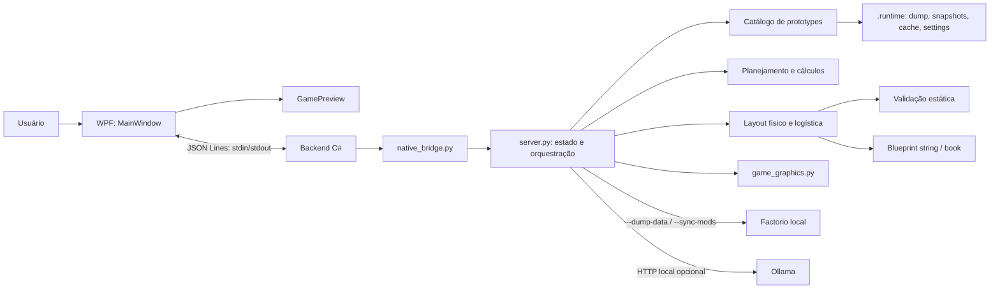
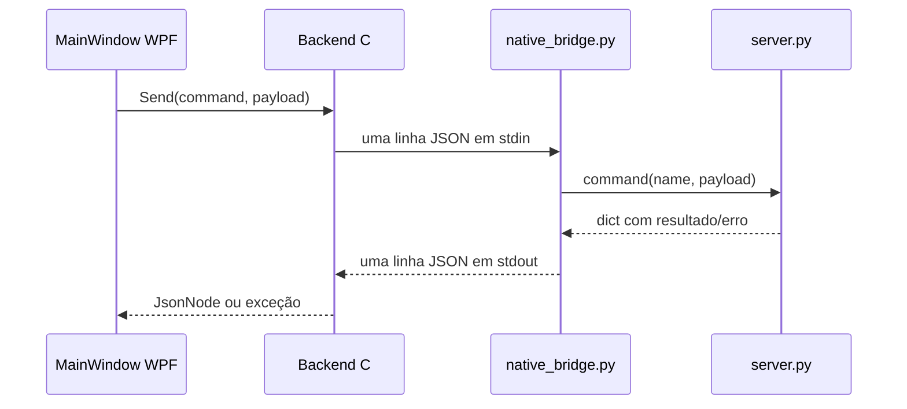
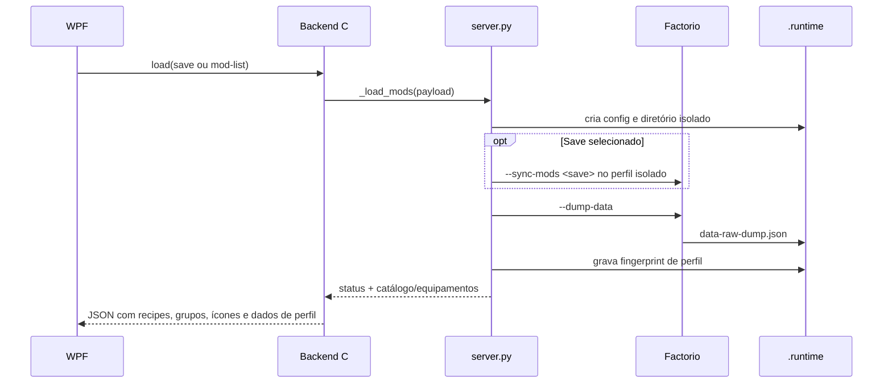
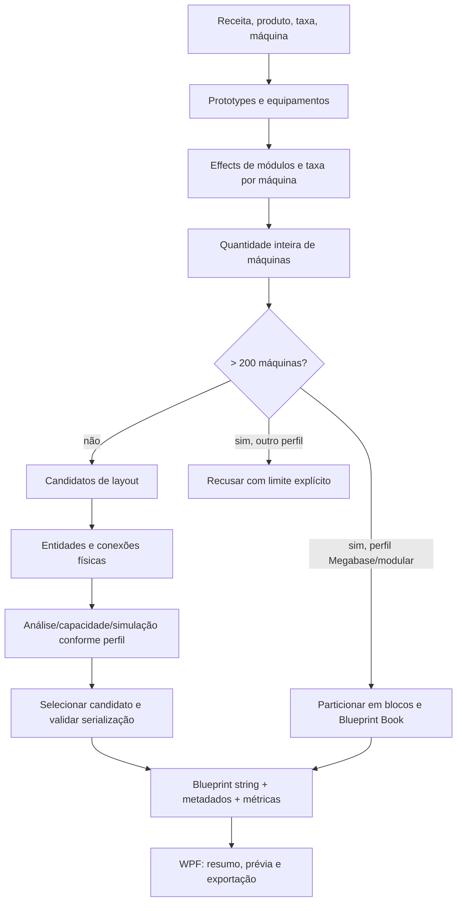
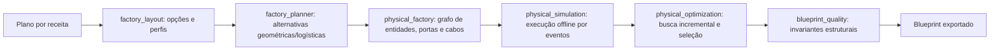
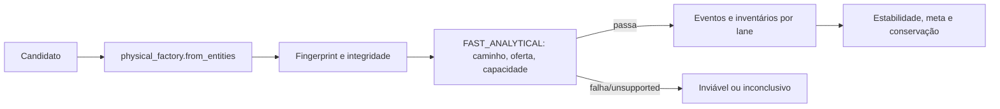
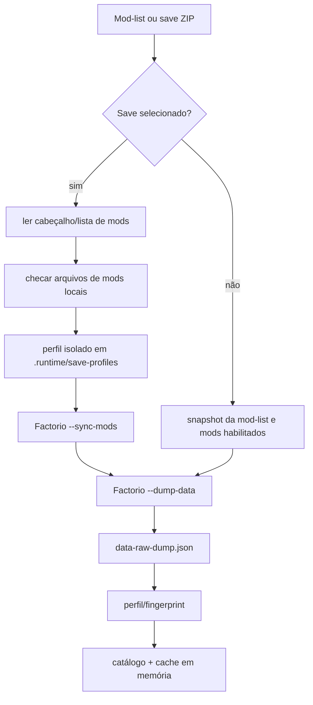
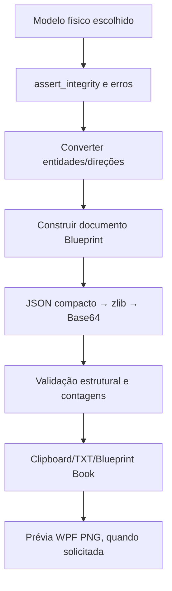
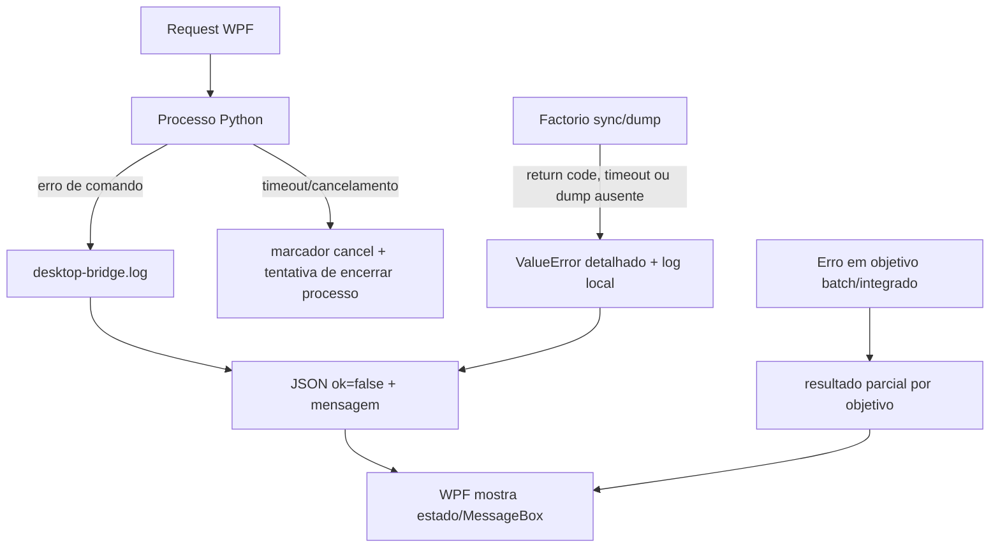

# Arquitetura completa

**Projeto:** ForgePlan — Factorio AI Blueprint Generator  
**Verificado em:** 2026-11-05  
**Escopo:** inspeção estática do código atual e suíte unitária local. Não foi carregado perfil do Factorio nem feita validação operacional no jogo nesta revisão.

## Visão de arquitetura

ForgePlan é um aplicativo local para Windows. A interface atual é WPF/C#, e o motor de catálogo, cálculo e geração é Python. O desktop inicia um processo Python persistente (`native_bridge.py`) e troca uma linha JSON por comando usando stdin/stdout. O servidor HTTP de `server.py` e a pasta `web/` formam um caminho anterior ainda presente no código; o executável desktop não o inicia.

O WPF não referencia diretamente módulos Python: envia nomes de comando e objetos JSON. `native_bridge.command` despacha os comandos e complementa resultados com sprites e ícones. A lógica de domínio ainda está concentrada em `server.py`, que também mantém estado global, cache, integração com o executável e um servidor HTTP legado. Referências: [Backend e protocolo C#](../../desktop/Program.cs#L25), [despacho JSON Lines](../../native_bridge.py#L94), [estado e caminhos de runtime](../../server.py#L24), [servidor HTTP legado](../../server.py#L1794).

## Processo e limites entre camadas

| Camada | Responsabilidade e dados | Estado observado |
|---|---|---|
| WPF | Seleção de perfil/save/receita/produto/máquina; configuração; geração; resumo; prévia; cópia/exportação | Estado de tela e fila de objetivos em memória; preferências de equipamento/layout em JSON e `.runtime/last-factory.json` |
| Backend C# | Iniciar/reiniciar Python, serializar chamadas, serializar chamadas concorrentes, timeout e cancelamento | Um processo persistente por janela; `SemaphoreSlim` serializa requests |
| `native_bridge.py` | Traduz comandos JSON Lines para funções Python; inclui dados de gráficos para o WPF | Lê settings ao iniciar; grava erros do bridge em `.runtime/desktop-bridge.log` |
| `server.py` | Estado/configuração, descoberta do Factorio, perfil de mods, catálogo, IA, planejamento, geração e API HTTP antiga | `STATE`, `CATALOG_CACHE`, locks e arquivos em `.runtime` |
| Módulos de domínio | Matemática, dependências, geometria, simulação, qualidade, fluidos, balanceadores e gráficos | Predominantemente dados em memória; caches locais por módulo |
| Factorio | Carrega prototypes e mods por execução de comandos; não é o motor de simulação operacional do ForgePlan | Sua invocação pode escrever apenas no user-data isolado configurado pelo ForgePlan, segundo o fluxo implementado |

O backend C# inicia `python -u native_bridge.py`, redireciona as três streams e escreve/consome JSON Lines. Um `SemaphoreSlim` impede requests simultâneos no mesmo processo. Os comandos `generate`, `generate_batch` e `generate_integrated` usam um arquivo marcador de cancelamento em `.runtime/cancellations`; o desktop aguarda até 12 minutos e tenta parar o processo em timeout/cancelamento. Essa é a infraestrutura do desktop, não garantia de que cada etapa Python responda imediatamente ao cancelamento. [Código](../../desktop/Program.cs#L25-L90), [polling de comandos](../../native_bridge.py#L177-L190), [validação do marcador](../../server.py#L39-L47).

## Fluxo de dados

O save é lido como ZIP apenas para extrair o cabeçalho, versão e lista de mods. `save_profile.py` não interpreta a pesquisa desbloqueada, entidades construídas ou inventário do mundo. Assim, recipes/prototypes descrevem dados carregados pelos mods; não provam que a tecnologia correspondente foi pesquisada naquele save. O fluxo está implementado, mas não foi executado nesta revisão para evitar qualquer sincronização ou escrita operacional. [Parser do cabeçalho](../../save_profile.py#L10), [preparação isolada](../../save_profile.py#L69), [sincronização e dump](../../server.py#L1652).

## Fluxo de geração

O caminho individual fica em `server._generate`; geração modular chama `_generate_modular` quando ultrapassa 200 máquinas e o perfil permite. O planejamento conjunto (`_plan_integrated`) agrega metas e ledger de coprodutos; `_generate_integrated` gera um bloco independente por receita da cadeia e um book, sem infraestrutura logística compartilhada. O lote de objetivos independentes continua sendo outro modo. [Geração individual](../../server.py#L1331), [dispatch para modular](../../server.py#L1420), [integração por ledger](../../server.py#L925), [geração integrada](../../server.py#L1074), [geração modular](../../server.py#L1165).

## Planejamento, geometria e simulação

Esse diagrama representa as responsabilidades reais, não uma garantia de que todo candidato percorra o mesmo modo ou que o modelo físico seja idêntico ao jogo. A versão rápida e o modelo temporal têm diferentes custos e níveis de detalhe. A simulação trabalha sobre entidades/portas e estimativas de capacidade fornecidas pelo código; não invoca a simulação interna do Factorio. Ver detalhes em [geração física](BLUEPRINT-GENERATION.md), [logística](LOGISTICS-ENGINE.md), [simulação temporal](TEMPORAL-SIMULATION.md) e [otimização](OPTIMIZATION-ENGINE.md).

## Save, mods e cache

Snapshot e dump apontam para diretórios de runtime locais. O fingerprint combina mods habilitados, versões, estatísticas dos arquivos, hash de `mod-settings.dat` e versão do jogo. O hash dos arquivos de mod não é calculado; nome/tamanho/mtime pode não detectar toda substituição de conteúdo. `_catalog` também associa o cache ao `mtime` do dump e fingerprint do perfil. [Fingerprint](../../server.py#L253), [snapshot](../../server.py#L294), [cache do catálogo](../../server.py#L382).

## Exportação

O book agrega strings de blueprints já gerados. O caminho exportador não abre o jogo nem prova importação. [Serialização física](../../physical_factory.py#L486), [string e book legado](../../server.py#L794), [validador](../../blueprint_quality.py#L121).

## Comandos e interface HTTP anterior

O dispatcher desktop implementa `game_area`, `status`, `saves`, `ollama`, `settings`, `load`, `machines`, `generate`, `generate_balancer`, `plan_integrated`, `generate_integrated` e `generate_batch`. A interface HTTP de `server.py` é um caminho legado com `Handler` e `ThreadingHTTPServer`, bind em `127.0.0.1`, porta padrão `8765`; ela pode servir `web/` e os endpoints `/api/*`, mas não é usada por `desktop/Program.cs`. [Dispatcher](../../native_bridge.py#L94), [rotas](../../server.py#L1818), [servidor standalone](../../server.py#L1907), [README](../../README.md#L3).

## Falhas e recuperação

O tratamento de erro evita expor traceback na resposta JSON do bridge; a exceção completa é acrescentada ao log local. O batch e a geração integrada guardam resultados parciais por bloco. O caminho HTTP converte erros esperados em 400 e erros inesperados em 500. Esses comportamentos têm cobertura unitária parcial; não fizemos uma jornada de falha ponta a ponta da UI. [Bridge](../../native_bridge.py#L180), [batch](../../server.py#L898), [rotas HTTP](../../server.py#L1882), [UI e exportação](../../desktop/Program.cs#L789).

## Estado e riscos arquiteturais

- O desenho é simples para uma aplicação local offline: dependências de execução ficam no computador do usuário, e o catálogo vem dos prototypes carregados pela instalação/mods.
- `server.py` acumula estado, integração com sistema de arquivos/processos, API HTTP antiga, catálogo, Ollama e geração. Isso eleva custo de revisão e risco de efeitos colaterais cruzados.
- A interface nova e a HTTP antiga continuam coexistindo; os contratos diferem. Não há empacotamento Python formal identificado; o produto depende do Python instalado/configurado e do executável local do Factorio.
- O projeto contém executáveis e diretórios de build pré-gerados. `build.ps1` direciona saída para `app-next`, enquanto `start.ps1` abre `app`; `ForgePlan.cmd` prefere `app-next` quando presente. Registrar essa diferença antes de padronizar instalação.
- A cópia isolada dos mods reduz escrita nos diretórios de origem, mas a geração e as métricas são offline. Importação, construção e throughput real permanecem sem validação operacional nesta revisão.
- Não há `.git` no diretório de trabalho; o conteúdo não foi associado a um commit/branch.

## Diagramas complementares

O diagrama geral cobre a integração WPF↔Python e Factorio. O fluxo do save/mod está acima. Cadeia matemática, fluido, módulos, topologias, perfis e validação são detalhados nos documentos técnicos ligados no [índice](README.md). A simulação física e temporal deve ser entendida como um modelo offline reproduzível, não como telemetria de uma fábrica no jogo.
