# Geração física de blueprints

**Escopo:** geometria, topologias, modelo físico canônico, exportação e validação offline do ForgePlan. A fonte de comportamento é o código atual. Os casos históricos citados foram avaliados offline; nenhuma taxa deste documento representa uma validação dentro do Factorio.

## Estado resumido

| Capacidade | Estado | Evidência e limite |
|---|---|---|
| Gerar entidades, coordenadas, orientações, portas e fios a partir de uma linha | Implementado; verificação offline disponível | O caminho físico reconstrói o grafo das entidades efetivas. Ainda não confirma que o jogo importa ou opera o resultado. |
| Manter identidade entre geometria simulada e exportada | Implementado | SHA-256 sobre o modelo selado; o validador compara entidades exportadas com as do modelo. |
| Evitar colisões e detectar prototypes ausentes | Implementado em análise estática | Usa caixas de colisão carregadas. Não cobre todos os comportamentos de placement da engine/mods. |
| Produzir layouts de esteiras, robôs ou máquinas | Parcial | O planejador legado monta esses modos. A otimização/simulação física atual exige `mode == "belts"`. |
| Emitir as topologias físicas atuais | Implementado; validação operacional pendente | O construtor cria entidades e contratos de interface; a estabilidade calculada é offline. |
| Importação, conexão e produção real no Factorio | Não verificado | Não há evidência de execução in-game nos artefatos consultados. |

## Fluxo de geração

```mermaid
flowchart LR
  P[Plano e configuração] --> B[factory_planner.build]
  B --> E[Entidades, portas e fios]
  E --> M[physical_factory.from_entities]
  M --> S[Modelo selado e grafo espacial]
  S --> F[fast_physical]
  F --> T[simulate_physical]
  T --> O[Busca e score dos candidatos]
  O --> X[export_entities / export_blueprint]
  X --> V[Validação estrutural offline]
  V --> R[String e entidades para a interface]
```

O caminho é construído em [`physical_factory.build_candidate`](../../physical_factory.py#L366), que chama o planejador de geometria, aplica a topologia selecionada e deriva um modelo físico com [`from_entities`](../../physical_factory.py#L81). A busca por candidatos está em [`physical_optimization.optimize_factory`](../../physical_optimization.py#L121). Ela serializa e valida cada blueprint antes de reter o candidato. A geometria que segue para exportação vem do modelo físico escolhido, não de uma reconstrução independente.

## Modelo canônico e integridade

`from_entities` recebe prototypes carregados, plano, entidades serializáveis, portas, fios, topologia e configuração. Ele gera os registros usados tanto pela análise quanto pela exportação:

| Registro | Representação | Uso |
|---|---|---|
| Entidade | `entity_number`, nome do prototype, posição, direção e propriedades de blueprint | Entrada autoritativa para a exportação. |
| Máquina | Entidade que corresponde à máquina e à receita do plano | Destino de braços e instância do simulador. |
| Nó de logística | Belt por canal/faixa; contêiner como nó de inventário | Fila e capacidade no simulador físico. |
| Próximo nó | Ligação inferida por tile ocupado, orientação e faixa | Transporte e busca de caminho. |
| Braço (`inserter`) | Posição, pickup, drop, endpoints, filtro e propriedades do prototype | Transporte entre belt, máquina e contêiner. |
| Porta | Material, papel (`input`, `output` ou `pass_through`), faixa, posição, taxa e capacidade | Contrato explícito com logística e suprimento externo. |
| Energia | Conectores externos, postes alcançados, fios e kW requerido pelas máquinas elétricas | Validação de conectividade/cobertura e entrada para hipóteses de energia. |

Os IDs de entidade precisam ser inteiros positivos e únicos. Para colisões, o modelo transforma a caixa de colisão do prototype em limites espaciais e indexa tiles ocupados. O grafo de belt é inferido pelos tiles vizinhos, direções e alinhamento de faixas; a coluna do planner não basta para formar uma conexão. O código registra erros separados de invalidez e recursos não suportados. [`from_entities`](../../physical_factory.py#L81)

O hash é SHA-256 de JSON canônico (chaves ordenadas, separadores compactos e NaN proibido). `seal` grava a impressão digital; `assert_integrity` recalcula e rejeita modelo alterado após construção. Isso evita usar um grafo obsoleto após mutação dos dados. A proteção detecta divergência do objeto em memória; não prova a fidelidade do modelo da engine. [`digest`, `seal`, `assert_integrity`](../../physical_factory.py#L20)

Orientações internas usam quatro direções cardeais codificadas em oito posições. A checagem física rejeita direções fora desse conjunto. Ao exportar para Factorio 2.x, o gerador duplica a direção interna para a convenção de 16 direções. A caixa de colisão volta a ser calculada pelo validador com a versão-alvo informada. [`VECTORS` e `_rotate`](../../physical_factory.py#L16), [`export_entities`](../../physical_factory.py#L486), [`_bounds`](../../blueprint_quality.py#L152)

## Geometria base

`factory_layout.footprint` deriva largura e altura do prototype, preferindo `tile_width`/`tile_height` e usando `collision_box` como fallback. A construção reserva tiles por footprint, alinha entidades à grade e rejeita sobreposição antes de acrescentar cada entidade. A cobertura elétrica usa alcance e área do prototype dos postes, cria relés quando necessário e liga a rede por fios. [`footprint`, `options`](../../factory_layout.py#L16), [`_build_single`](../../factory_planner.py#L70)

O planner calcula demandas por máquina, restringe máquinas por capacidade nominal da belt, inserter, fluid line configurada e limites de layout. Depois avalia arranjos de colunas/linhas com pesos de área, belt, máquinas ociosas, postes, fios e desperdício de slots. O perfil `city_block` aplica um limite de dimensão e snap-to-grid; é um perfil/restrição geométrica, não uma topologia de roteamento de cidade implementada separadamente. [`layout_candidates`](../../factory_planner.py#L10), [`pareto_frontier`](../../factory_planner.py#L54), [`_build_single`](../../factory_planner.py#L70), [`build`](../../factory_planner.py#L529)

Quando há uma área alvo importada, `build` testa o layout, procura alternativas se a geometria for automática, e rejeita configurações fixas que excedam a área. O desenho final retorna dimensões, área, entidades, bill of materials, portas, wires, capacidades, assignments de faixas e checks estruturais. Essas métricas descrevem o candidato gerado; não confirmam que a área está livre no mapa do usuário. [`build`](../../factory_planner.py#L529)

## Topologias físicas

Os nomes que o construtor de modelo aceita estão em `TOPOLOGIES`: `linear`, `parallel_rows`, `central`, `dual_end`, `independent_blocks` e `repeatable`. `smelting_block` segue um construtor especial. A busca pode ainda criar variantes específicas de fundição. [`TOPOLOGIES`](../../physical_factory.py#L16), [`build_candidate`](../../physical_factory.py#L366)

| Topologia | Geometria atual | Contratos/observações |
|---|---|---|
| `linear` | Layout base do planejador, com fileiras e belt associada a cada row. | Caso inicial para gerar e comparar candidatos. |
| `parallel_rows` | Divide máquinas por mais rows; cada row tem interfaces físicas próprias. | Reduz distâncias em alguns casos e aumenta fornecedores/interfaces e área. |
| `central` | Interrompe cada run de entrada no meio, reorienta os dois ramos para fora e acrescenta feeder belts acessíveis. | Duas interfaces de entrada por row; o mapeamento da faixa é transformado para o lado relativo ao fluxo. |
| `dual_end` | Separa a alimentação pelas extremidades e orienta os ramos em direções opostas. | Requer pelo menos duas máquinas por row para cada row avaliada. |
| `independent_blocks` | Restringe colunas pelo `module_size`, gerando mais rows e seus próprios acessos. | É partitionamento geométrico da geração atual; os contratos e a vazão total devem ser avaliados para o conjunto. |
| `repeatable` | Acrescenta portas `pass_through` ao fim dos barramentos de entrada. | `connect_repeated` pode duplicar de 1 a 16 cópias sem rotação, unir belt de saída, IDs, fios e rede elétrica e recalcular o plano total. A repetição não multiplica capacidade por si só. |
| `smelting_block` | Layout especial de fundição definido por `smelting_layout.build_smelting`. | Usado para forno; emprega função de extensão própria. |
| `smelting_repeat_body` / `extended_smelting` | `smelting_body` extrai um corpo com barramentos e portas; `extend_smelting` duplica até oito corpos ligados ao cabeçalho e potência. | Variante de fundição, não entrada de `TOPOLOGIES`. |
| `parallel_smelting_blocks` | `parallel_copies` replica de 1 a 8 blocos, com contratos próprios de supply/power e opção de compartilhar faixa lateral de combustível. | Blocos físicos gerados; throughput agregado ainda depende do fornecimento contratado. |

Os detalhes de construção estão em [`build_candidate`](../../physical_factory.py#L366), [`connect_repeated`](../../physical_factory.py#L498), [`smelting_body`](../../physical_factory.py#L550), [`extend_smelting`](../../physical_factory.py#L582) e [`parallel_copies`](../../physical_factory.py#L627). A otimização automática das variantes especiais está em [`optimize_factory`](../../physical_optimization.py#L121).

## Exportação e verificações

`export_entities` verifica o hash e exige que o modelo não tenha erros. Em seguida converte direções para a versão 2.x. `export_blueprint` monta o documento `blueprint`, coloca versão codificada, entidades, wires e ícone, adiciona snap-to-grid quando solicitado e serializa JSON compacto com zlib nível 9 e prefixo `0` seguido de Base64. [`export_entities`](../../physical_factory.py#L486), [`export_blueprint`](../../physical_factory.py#L696)

`validate_blueprint_string` limita payload descomprimido a 64 MiB e verifica marcador, Base64, zlib, JSON, lista de entidades, IDs, filtros, seções logísticas, wires e Blueprint Books aninhados. O validador aceita um subconjunto documentado do formato e confere a contagem esperada de entidades. [`validate_blueprint_string`](../../blueprint_quality.py#L121)

`blueprint_quality.analyze` verifica prototypes, IDs, posição/orientação, caixas de colisão, checks de layout, cobertura elétrica e conectividade nominal. Se houver `physical_model`, recalcula integridade e compara as entidades exportadas e portas com o modelo. A checagem de flow para o caminho físico chama a análise rápida; no layout legado, verifica capacidades agregadas planejadas e assume explicitamente que não é simulação de adjacência. [`_flow_graph`](../../blueprint_quality.py#L174), [`analyze`](../../blueprint_quality.py#L251)

Essas verificações são estáticas. Elas não carregam a blueprint na engine, não avaliam todos os pré-requisitos de construção, pesquisa, alcance do jogador, superfície, ocupação de mapa, qualidade/modifiers arbitrários nem rede logística externa real.

## Limitações confirmadas do modelo

- O caminho de otimização física rejeita modos diferentes de belt. Planejamento por robôs e modo `machines` seguem o fluxo legado sem otimização temporal física. [`build_candidate`](../../physical_factory.py#L366)
- Os nós de faixa usam lanes discretas e conectividade inferida. A curva, side-loading e seleção de lane são aproximações; alguns comportamentos de splitter são simplificados no simulador. [`from_entities`](../../physical_factory.py#L81), [`simulate_physical`](../../physical_simulation.py#L166)
- Códigos de controle de belts/máquinas/inserters, stacks, qualidade produzida, rendimentos estocásticos, recirculação do mesmo item como entrada e produto, fluidos e loaders podem causar `unsupported` ou impedir avaliação temporal. [`from_entities`](../../physical_factory.py#L81)
- O custo de infraestrutura soma ingredientes diretos das receitas de colocação, sem recursão de minério, moeda ou preços. [`_cost`](../../physical_factory.py#L53)
- `independent_blocks`, `repeatable` e blocos de fundição oferecem geometria e interfaces explícitas. A replicação não valida throughput agregado fora das fontes e sinks simulados. [`connect_repeated`](../../physical_factory.py#L498), [`parallel_copies`](../../physical_factory.py#L627)

## Evidência offline histórica

O caso vermelho usa 23 `assembling-machine-2`, receita de 5 s, velocidade 0,75, portanto 9 crafts/min por máquina e 207/min teóricos. Com 23 máquinas, as entradas de copper plate e iron gear wheel são 207/min cada; a capacidade nominal por lane da belt amarela no ensaio é 450/min. O relatório de 25/10/2026 registra seis candidatos físicos: linear, duas rows, central, dual-end, independent blocks e repeatable. A string linear foi selecionada com score 2907,13; as seis simulações foram `STABLE`, sustentaram 207/min e conservaram os balanços reportados. Esses resultados são offline, ligados a um dump de prototypes local. Os JSON não guardam versão do Factorio nem hash do dump; portanto, a versão exata usada na execução histórica não pode ser comprovada por esses artefatos.

Referências: [relatório físico/temporal](../blueprint-quality/PHYSICAL-TEMPORAL-OPTIMIZATION.md#L32), [comparação de candidatos](../../outputs/physical-temporal/red-science/comparison.json), [convergência temporal](../../outputs/physical-temporal/red-science/convergence.json), [modelo físico escolhido](../../outputs/physical-temporal/red-science/selected.physical-model.json). O runner [`run_physical_cases.py`](../blueprint-quality/cases/run_physical_cases.py#L1) declara que lê um dump existente e não inicia o Factorio. O relatório registra 82 testes e build WPF em 25/10; são validações históricas, não uma execução realizada nesta documentação. [Relatório de validação](../blueprint-quality/PHYSICAL-TEMPORAL-OPTIMIZATION.md#L126)

## Referências do código

- [`physical_factory.py`](../../physical_factory.py): modelo, grafo, topologias, repetição e exportação.
- [`factory_planner.py`](../../factory_planner.py) e [`factory_layout.py`](../../factory_layout.py): footprints, construção, layout, potência e portas.
- [`blueprint_quality.py`](../../blueprint_quality.py): esquema e verificações offline.
- [`physical_optimization.py`](../../physical_optimization.py): busca, seleção e score dos candidatos.
