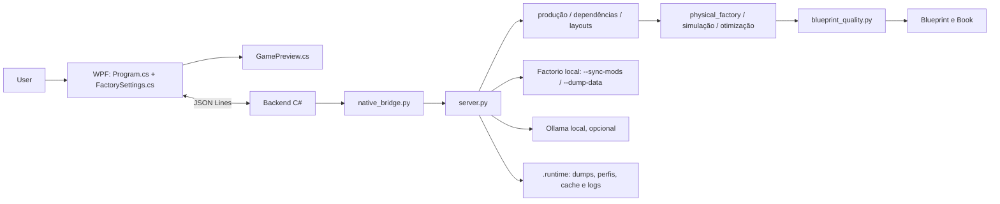

# ForgePlan — relatório executivo e técnico

**Produto:** ForgePlan — Factorio AI Blueprint Generator  
**Data desta revisão:** 2026-11-05  
**Escopo:** leitura do código e documentos locais, inventário de artefatos e execução da suíte unitária Python. Nenhuma alteração de código de produção, operação do Factorio, sincronização de save ou build WPF foi realizada.

## 1. Sumário executivo

ForgePlan é um aplicativo local de planejamento e geração de blueprints para Factorio. A interface atual é WPF/C#; o motor é Python e obtém receitas, máquinas, esteiras, inserters e outros prototypes dos dados carregados pelo executável local do Factorio. O sistema calcula quantidade de máquinas, escolhe uma geometria, constrói entidades/conexões, pode analisar a fábrica com simuladores offline e exporta strings de blueprint ou Blueprint Books.

Há três modos que não devem ser confundidos: **batch independente** gera um plano por objetivo; **planejamento integrado** estima receitas compartilhando ledger de coprodutos e depois gera um bloco separado por etapa; **geração modular** divide metas grandes em blueprints por blocos. Lotes e livros passam por validações estáticas, mas não formam automaticamente uma fábrica conectada. Os limites e diferenças estão em [geração múltipla e megabases](PRODUCTION-ENGINE.md), [otimização](OPTIMIZATION-ENGINE.md) e [geração física](BLUEPRINT-GENERATION.md).

A revisão executou `rtk test python -m unittest discover -s tests -v`: **123 testes passaram em 75,461 s**. Isso sustenta a lógica Python coberta pelas fixtures. Não é evidência de importação, construção, estabilidade ou throughput dentro do Factorio. O estado de pesquisa do save não é interpretado; a rede temporal de fluidos não é simulada; módulos de uma megabase não recebem barramentos/energia compartilhados; os artefatos de desempenho são pontuais e históricos.

**Avaliação executiva:** protótipo local com planejamento e modelagem física offline substanciais, mas a confiança operacional dos blueprints continua aberta. Prioridade: construir um protocolo descartável de importação/medição e usar os resultados para calibrar logística, fluidos e contrato modular.

## 2. Produto, problema e usuários

O produto reduz o trabalho de converter uma meta de produção em quantidades de máquinas, equipamentos, layout e blueprint. O usuário escolhe uma receita/produto/taxa, seleciona máquinas e equipamentos compatíveis, escolhe prioridades de otimização e recebe resumo, prévia e string de blueprint.

Público provável: jogadores de Factorio que conhecem receitas e querem prototipar linhas, modders que precisam usar dados de recipes modded e desenvolvedores que avaliam layouts em lote. Diferencial principal: ler prototypes locais em vez de manter um catálogo vanilla fixo, combinar cálculo com geração geométrica e oferecer avaliação física/temporal offline.

Os objetivos de “fábrica ideal”, “megabase” e “IA para layouts” são capacidades graduais. O código demonstra geração e análise offline; não demonstra uma fábrica ideal nem operação sustentada no jogo.

## 3. Capacidades e maturidade

### Legenda

- **Implementado e validado offline:** coberto por teste/fixture ou validação estática reproduzível; não implica validação no jogo.
- **Implementado, não validado operacionalmente:** caminho presente; importação/produção real não foi comprovada nesta revisão.
- **Parcial/experimental:** parte do comportamento existe, com limites relevantes ou modelo simplificado.
- **Ausente/não verificado:** não encontrado ou sem evidência disponível. “Não verificado” não significa que certamente falha.
- **Defeituoso:** comportamento incorreto confirmado. Nenhum defeito operacional de blueprint foi confirmado nesta revisão.

| Área | Estado atual | Evidência e limite |
|---|---|---|
| Desktop WPF e preview | Implementado; jornada visual não executada | [Program.cs](../../desktop/Program.cs#L148), [preview](../../desktop/GamePreview.cs#L14) |
| Comunicação WPF→Python | Implementado; unidade ponta a ponta não avaliada | [Backend](../../desktop/Program.cs#L25), [bridge](../../native_bridge.py#L94) |
| Descoberta de Factorio, save e mod-list | Implementado; save lido por cabeçalho, fluxo sync/dump não executado nesta revisão | [descoberta](../../server.py#L63), [parser](../../save_profile.py#L10), [loader](../../server.py#L1652) |
| Catálogo de prototypes | Implementado e coberto por testes | [catálogo](../../server.py#L382), [tests](../../tests/test_catalog.py#L10) |
| Taxa e máquinas | Implementado como cálculo; throughput real não validado | [geração](../../server.py#L1331), [math](../../production_math.py) |
| Dependências e ledger | Recursão implementada; plano conjunto usa ledger compartilhado de coprodutos | [dependency planner](../../dependency_planner.py), [integrated planner](../../server.py#L925) |
| Layout físico e serialização | Implementado; checks offline e testes | [factory planner](../../factory_planner.py), [physical factory](../../physical_factory.py), [quality](../../blueprint_quality.py) |
| Simulação temporal de itens | Implementada; validação contra o jogo ausente | [engine](../../physical_simulation.py), [testes](../../tests/test_physical_simulation.py) |
| Fluidos | Geometria/portas implementadas; simulação temporal de rede ausente | [fluid layout](../../fluid_layout.py), [limites](LOGISTICS-ENGINE.md) |
| Balanceadores | Biblioteca restrita a topologias explícitas; geometria pode ser emitida | [balancers](../../balancer_library.py), [testes](../../tests/test_balancer_library.py) |
| Ollama | Opcional; sugere dimensão/colunas, sem ganho comparativo medido | [API/IA](../../server.py#L572), [AI-INTEGRATION.md](AI-INTEGRATION.md) |
| Batch de metas independentes | Implementado; falha individual pode preservar sucessos | [batch](../../server.py#L898), [testes](../../tests/test_catalog.py#L108) |
| Plano integrado | Implementado com ledger heurístico e blocos de receita separados | [planejador](../../server.py#L925), [gerador](../../server.py#L1074) |
| Books/modularização | Implementados com limites por bloco; conexões e infraestrutura agregada não geradas | [modular](../../server.py#L1165), [limitações](KNOWN-ISSUES-AND-LIMITATIONS.md) |
| Importação/throughput no Factorio | Não verificado | Não executado por escopo; não há resultado atual de validação operacional |

## 4. Experiência do usuário

1. Abrir o `.exe` WPF e selecionar mod-list ativa ou save local; opcionalmente localizar outro `.zip` de save/mod.
2. Carregar o perfil. O backend resolve o executável e os mods locais, cria snapshot/perfil em `.runtime`, pede ao Factorio que sincronize mods para perfil de save quando solicitado e chama `--dump-data`.
3. Filtrar o catálogo por grupos/subgrupos, pesquisar e escolher recipe, item/fluid de saída, taxa e máquina compatível.
4. Configurar esteiras, inserters, postes, módulos, perfil de otimização, arranjo, rotação, espaçamento e área capturada opcional.
5. Gerar um blueprint, várias fábricas independentes, plano integrado ou balanceador. Ver resumo/métricas/avisos e prévia 2.5D; copiar ou exportar string/book para TXT e imagem preview para PNG.

Os nomes dos botões e estado de cada aba estão em [UI-USER-GUIDE.md](UI-USER-GUIDE.md). A UI persiste configurações locais, mas a árvore de tecnologia do save não é usada para bloquear receitas.

## 5. Arquitetura

O desktop inicia um processo Python persistente e serializa chamadas por semáforo. A interface HTTP de `server.py` continua no checkout e pode servir a UI web antiga, mas não é aberta pelo desktop. A maior parte da integração e fluxo de geração fica em `server.py`, enquanto cálculos e simuladores estão em módulos específicos.

Veja [ARCHITECTURE-COMPLETE.md](ARCHITECTURE-COMPLETE.md) para diagramas de sequência e fluxos de falhas; [COMPONENTS-REFERENCE.md](COMPONENTS-REFERENCE.md) lista os arquivos e responsabilidades.

## 6. Tecnologias e dependências

| Elemento | Uso |
|---|---|
| Python 3.10+ / biblioteca padrão | Motor, processo bridge, IO de ZIP/JSON, HTTP local, cálculos |
| C# / .NET 10 WPF | Desktop Windows e prévia |
| Factorio instalado | Prototypes do jogo/mod e metadados de save; fonte de dados, não simulador chamado por candidato |
| Ollama local (opcional) | Resposta estruturada curta sugerindo arranjo/colunas |
| Lua | Mod opcional ForgePlan Area Bridge para capturar retângulo/superfície/origem do jogo |

Não há manifest de dependências Python identificado. O build WPF usa `desktop/ForgePlan.Desktop.csproj`, que aponta a `net10.0-windows`. Os launchers não selecionam exatamente o mesmo diretório após build: `build.ps1` escreve em `app-next`, `start.ps1` abre `app` e `ForgePlan.cmd` prioriza `app-next`.

## 7. Integração com Factorio, saves e mods

O executável é descoberto por configuração/variável, caminhos comuns e bibliotecas Steam. O perfil de mods lê `mod-list.json`; os saves são listados em diretórios locais. O parser abre `level-init.dat` dentro do ZIP, extrai versão e lista de mods (inclui CRC do cabeçalho) e prepara diretório isolado. O loader invoca `--sync-mods` com save selecionado e `--dump-data` para gerar `data-raw-dump.json`.

O `fingerprint` combina nomes/versões, metadados de arquivos, hash de `mod-settings.dat` e versão do Factorio. O conteúdo integral de cada mod e o CRC do save não são comparados. Pesquisa/unlocks específicos do mundo também não são extraídos. O catálogo representa prototypes carregados, não necessariamente receitas disponíveis àquele jogador. Fluxo detalhado e limites: [FACTORIO-MOD-INTEGRATION.md](FACTORIO-MOD-INTEGRATION.md).

## 8. Catálogo

O backend deriva produtos/ingredientes de recipes e expõe nomes de itens, receitas, fluídos, grupos/subgrupos, ícones e escolhas de máquinas. A WPF oferece filtro de grupo/subgrupo, busca, seleção de receita e saída. Nomes localizados vêm dos prototypes quando string simples está disponível; `LocalisedString` complexo pode cair em fallback em vez de ser resolvido integralmente. A construção de payload fica em [server.py](../../server.py#L407) e [native bridge](../../native_bridge.py#L27).

## 9. Motor de produção e exemplo

Por receita, a taxa-base por máquina deriva de `crafting_speed`, duração da receita, quantidade do produto e efeitos aplicáveis; produtividade acrescenta output quando a receita permite. Número inteiro dimensionado é teto da meta dividido pela produção estimada por máquina. Módulos influenciam velocidade/produtividade/consumo; inserters e belts adicionam restrições posteriores. As equações, arredondamentos, probabilidades/coprodutos e limites estão em [PRODUCTION-ENGINE.md](PRODUCTION-ENGINE.md).

**Exemplo ilustrativo:** no caso offline documentado para Automação Science Pack, cada uma de 23 máquinas Assembly 2 produz aproximadamente 9/min sob os prototypes/configuração daquele caso. `23 × 9 = 207/min`; isso cobre uma meta de 200/min com 3,5% de margem nominal. A simulação física reportou esse cenário em métricas offline, não em partida. Não extrapolar para módulos, outros mods, falta de insumos ou bloqueio real. Fonte: [caso temporal](../blueprint-quality/PHYSICAL-TEMPORAL-OPTIMIZATION.md#L32).

O motor de single-recipe usa matérias-primas externas na fronteira do blueprint. Para gerar uma cadeia, o planejador recursivo estima receitas e entradas externas; no plano integrado, vários objetivos podem compartilhar coprodutos. [PRODUCTION-ENGINE.md](PRODUCTION-ENGINE.md) descreve o exemplo e limites.

## 10. Geração física de blueprints

A representação inclui entidades, IDs, posição, orientação, fios, endpoints, portas, fontes de insumos, saídas e dados de protótipos. O modelo físico é derivado das entidades candidatas; hashes protegem contra simular/exportar uma geometria mutada. O serializador codifica JSON comprimido em base64 e inclui versão do jogo. A validação estática inspeciona estrutura, filtros, IDs, conexões e contagens.

Topologias efetivamente encontradas incluem linear, fileiras paralelas, alimentação central, dois extremos, blocos independentes e repetível; existem também layouts especializados de fundição. A seleção varia por perfil e disponibilidade de equipment/prototype. Geometria, transformação de rotação e hash: [BLUEPRINT-GENERATION.md](BLUEPRINT-GENERATION.md).

## 11. Logística e fluidos

O código calcula taxa total/por faixa com margem, pode combinar dois materiais em lanes separadas, alimentar em belt dedicado ou repartir demanda em até duas entradas conforme capacidade, espaço e inserters disponíveis. O cálculo de inserter usa prototype e margem conservadora. Balanceadores são catálogos de topologias exatas disponíveis no jogo; não se promovem módulos 4→4 como equivalentes universais.

Os roteadores de fluido derivam coordenadas de portas a partir de fluidboxes e terminam em coletores externos separados. A simulação temporal de item não modela a dinâmica do fluido; certas geometrias de modded fluidboxes podem ser recusadas. Detalhes, fórmulas de faixa e recomendações: [LOGISTICS-ENGINE.md](LOGISTICS-ENGINE.md).

## 12. Simulação temporal

O simulador usa um grafo físico derivado de entidades, inventários/buffers e eventos para transportar itens, processar inserters e ciclos de máquina, contabilizar taxa, starvation, bloqueio e conservação. Configura período de warm-up, janela de medição, convergência, limite de tempo, cancelamento, memória e cache. A versão rápida estima capacidade/caminhos com menos custo; a simulação temporal avança eventos de transferência.

O modelo é determinístico/offline e inclui limitações para splitters, undergrounds, side-loading, fluidos e estado de energia/insumos externos. Suites e métricas mostram comportamento dentro das próprias premissas; só jogo pode verificar equivalência real. Ver [TEMPORAL-SIMULATION.md](TEMPORAL-SIMULATION.md).

## 13. Otimização e scores

Perfis incluem compacto, equilibrado, máximo throughput nominal, eficiência, metalurgia de referência, megabase, city block e personalizado. O planejador enumera layouts candidatos com limites e scores de área/custo/logística; a otimização física usa cache e orçamento de busca. Isso seleciona o melhor candidato **avaliado dentro do perfil e orçamento**, não um ótimo global de todas as fábricas possíveis. Fórmulas e limites: [OPTIMIZATION-ENGINE.md](OPTIMIZATION-ENGINE.md).

## 14. IA

Ollama é opcional e acessado via HTTP local. O modelo recebe contexto/prompt de uma fábrica e sugere valor de colunas/arranjo; validações determinísticas podem recusar a sugestão se quebrar limites. A IA não define receita, balanço material nem prova throughput. Não há comparação cega demonstrando melhora em área, score ou taxa. Veja [AI-INTEGRATION.md](AI-INTEGRATION.md).

## 15. Múltiplos produtos, books e megabases

- **Batch independente:** uma execução `_generate` por objetivo, preservando resultados parciais e agregando um book.
- **Integrado:** plano por ledger de coprodutos; gera um blueprint por receita usada. Blocos continuam desconectados e interfaces recebem insumos externamente.
- **Modular:** para metas acima de 200 máquinas, o perfil megabase ou opção modular particiona em livros de blueprints por bloco, respeitando os limites configurados. Cada bloco tem portas externas; não recebe barramento, poste ou trilho de ligação automaticamente.
- **City block:** perfil que filtra por dimensão/snap/retângulo e favorece forma compatível; não é gerador completo de ruas, rails, roboports ou conexões city-block.

Replicar a planta preserva forma, não prova throughput agregado. Limites e exemplos em [PRODUCTION-ENGINE.md](PRODUCTION-ENGINE.md), [OPTIMIZATION-ENGINE.md](OPTIMIZATION-ENGINE.md) e [KNOWN-ISSUES-AND-LIMITATIONS.md](KNOWN-ISSUES-AND-LIMITATIONS.md).

## 16. Validação, segurança e confiabilidade

Blueprints são verificados estruturalmente antes de exportar, incluindo algumas formas antigas de filtro e inconsistências de IDs/conexões. Nomes de mods recebem validação e caminhos derivados verificam containment; arquivos symlink de mods são recusados em snapshots. Essas verificações reduzem riscos de parser e path, mas não substituem fuzzing nem execução de Factorio.

Um relato histórico de Factorio 2.1.23 registrou uma asserção `LogisticSections::save` durante autosave de blueprint no inventário do personagem. O log não identifica a blueprint e não prova relação com ForgePlan. Avisos separados de comparador de filtro foram tratados em inserters; não há evidência de que isso explique ou resolva a asserção. O esquema atual do Factorio documenta as seções/filtros como estruturas próprias, mas a causa do evento continua aberta. [Relato local](../blueprint-quality/PHYSICAL-TEMPORAL-OPTIMIZATION.md#L94), [API oficial 2.1.24](https://lua-api.factorio.com/latest/concepts/LogisticSections.html).

Falhas do bridge retornam mensagem JSON e gravam traceback local; timeout/cancelamento pode encerrar processo. Lotes preservam falhas parciais. Riscos P1/P2 e critérios de aceite completos: [KNOWN-ISSUES-AND-LIMITATIONS.md](KNOWN-ISSUES-AND-LIMITATIONS.md).

## 17. Performance e testes

No teste corrente, 123 testes passaram. O relatório antigo mede importação/catálogo e exemplos de geração em subsegundo em uma máquina, usando dump Factorio 2.1.23, 71 mods e 488 recipes. São medidas únicas, não benchmarks repetidos; limite de 200 máquinas impediu testar escala nesse fluxo. Existem também métricas de candidatos offline datadas de 25/10/2026 sem versão/fingerprint do dump. [PERFORMANCE-AND-TESTING.md](PERFORMANCE-AND-TESTING.md).

Não rodamos build porque o script grava binários, nem `--sync-mods`, Factorio, importação, profiling, UI E2E ou benchmark controlado.

## 18. Limitações e riscos principais

1. Blueprint import e throughput ainda sem prova operacional nesta revisão.
2. Save parser não lê tecnologia pesquisada e CRC lido não confirma conteúdo local.
3. Fluido não está no simulador temporal; caminhos de item incorporam aproximações de física do jogo.
4. Books integrados/modulares mantêm blocos independentes, sem infraestrutura ou capacity budget agregado.
5. Métricas atuais são limitadas; o relatório de perf mais concreto é histórico e de execução única.
6. Estado global/cache e uma interface HTTP antiga aumentam superfície de manutenção; launchers divergem sobre o diretório do build.
7. Um crash histórico de salvamento no Factorio não foi atribuído ao ForgePlan nem descartado com teste específico.

Não há evidência nesta revisão para declarar um defeito operacional atual do exportador; estado correto é “não verificado”.

## 19. Roadmap recomendado

| Ordem | Entrega | Critério central |
|---:|---|---|
| 1 | Harness descartável de importação/medição | Blueprints do corpus importam e taxas/inventários são registrados sem save do usuário |
| 2 | Tecnologia pesquisada e fingerprint forte de mod | Perfil distingue disponibilidade/CRC/conteúdo e comunica requisitos |
| 3 | Calibração de belts/inserters/topologias e rede de fluido | Simulador atinge tolerância acordada ou recusa caso sem modelo |
| 4 | Contrato modular agregando portas, capacidade e energia | N blocos conectados sustentam N× taxa prevista em jogo |
| 5 | Benchmark do checkout atual | cold/warm, p50/p95, pico RSS e perfis fixos |
| 6 | Separar adaptadores/estado e unificar build/launch | Dois perfis não cruzam estado; launchers abrem mesmo build |
| 7 | Avaliação cega do Ollama | Ganho repetível sem reduzir validade |

Roadmap detalhado, dependências, risco e esforço relativo em [ROADMAP.md](ROADMAP.md).

## 20. Glossário

| Termo | Significado |
|---|---|
| Prototype | Descrição carregada pelo Factorio para item, recipe, máquina, fluido ou equipamento |
| Receita | Regra de crafting com duração, ingredientes e produtos |
| Inserter | Braço que transfere itens entre belt, chão, container e máquina |
| Lane/faixa | Uma das duas trilhas de itens de um transport belt |
| Coproduto | Produto adicional emitido pela mesma receita usada para atingir uma meta |
| Blueprint Book | Contêiner serializado que guarda vários blueprints selecionáveis |
| Throughput | Vazão sustentada realmente entregue ao longo do tempo |
| Fingerprint | Assinatura resumida usada para identificar perfil de mods/cache |
| Warm-up | Intervalo inicial descartado antes de medir taxa no simulador |
| Starvation | Máquina parada por falta de item de entrada |
| Backpressure | Bloqueio de produção causado por consumidor/saída sem espaço ou vazão |
| Modularização | Partição em blocos independentes; não implica conexão automática |

## 21. Referências

- [Índice de documentação](README.md)
- [Arquitetura](ARCHITECTURE-COMPLETE.md) · [Componentes](COMPONENTS-REFERENCE.md) · [Evidências](EVIDENCE-INDEX.md)
- [Produção](PRODUCTION-ENGINE.md) · [Blueprints](BLUEPRINT-GENERATION.md) · [Logística](LOGISTICS-ENGINE.md) · [Simulação](TEMPORAL-SIMULATION.md) · [Otimização](OPTIMIZATION-ENGINE.md)
- [UI](UI-USER-GUIDE.md) · [Mods](FACTORIO-MOD-INTEGRATION.md) · [IA](AI-INTEGRATION.md)
- [Performance/testes](PERFORMANCE-AND-TESTING.md) · [Limitações](KNOWN-ISSUES-AND-LIMITATIONS.md) · [Roadmap](ROADMAP.md)
