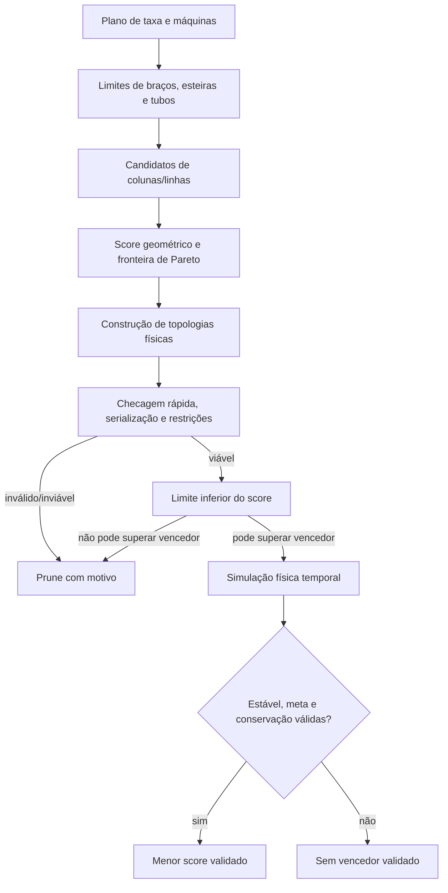

# Motor de otimização e seleção de candidatos

**Escopo:** seleção geométrica inicial, busca de topologias físicas, análise temporal e escolha por perfil.  
**Fonte examinada:** `factory_planner.py`, `physical_optimization.py`, `physical_factory.py` e rotas de geração em `server.py`.  
**Data da inspeção:** 2026-11-05.

## Resumo do funcionamento

O ForgePlan tem duas camadas relacionadas, mas diferentes:

1. `factory_planner.layout_candidates` escolhe colunas/linhas com um score geométrico e restrições logísticas.
2. `physical_optimization.optimize_factory` pode construir topologias físicas alternativas, validar/exportar cada blueprint, descartar candidatos incapazes e executar simulação temporal com orçamento limitado. Entre candidatos aprovados, seleciona o menor score do perfil. [factory_planner.py](../../factory_planner.py#L10), [physical_optimization.py](../../physical_optimization.py#L121).



## Seleção de layout convencional

`layout_candidates` enumera quantidades de colunas de 1 até o menor entre máquinas e limite da linha. Para cada geometria, calcula:

```text
linhas = ceil(máquinas / colunas)
passo_x = largura_da_máquina + vão
passo_y = altura + cabeceira + cauda + corredor
largura = colunas × passo_x - vão + 8
altura = linhas × passo_y - corredor + 6
área = largura × altura
tiles_de_esteira = linhas × linhas_logísticas × largura
máquinas_ociosas = linhas × colunas - máquinas
```

Estima postes e conexões elétricas a partir do espaçamento e do alcance do protótipo de poste. O score soma métricas ponderadas de área, esteira, posições ociosas, postes, fios e linhas. O perfil `megabase` acrescenta uma penalidade de 500 por máquina de diferença entre colunas e `module_size`; `city_block` penaliza overflow com 1.000.000 por tile e depois remove geometrias que excedam o bloco. [factory_planner.py — candidatos e pesos](../../factory_planner.py#L10).

`pareto_frontier` conserva candidatas não dominadas em área, esteiras, postes, fios, slots ociosos e overflow. A geometria escolhida é o menor score na fronteira, salvo arranjo manual, single row, `max_throughput` ou regra de `megabase`. Em `megabase`, auto seleciona `arrangement=rows` efetivo e restringe a escolha a até `module_size` colunas. Isso controla a forma da planta; por si só, **não** cria conectores logísticos, infraestrutura compartilhada nem demonstra escalabilidade agregada. [factory_planner.py — fronteira de Pareto](../../factory_planner.py#L54), [factory_planner.py — perfil, geometria e sugestões](../../factory_planner.py#L161).

Perfis de geometria em `factory_planner.py`:

| Perfil | Tendência pelos pesos/código |
|---|---|
| `compact` | Peso maior para área; reduz penalidade de esteiras. |
| `balanced` | Pesos intermediários padrão. |
| `max_throughput` | Penaliza linhas e slots ociosos; em auto tende a uma linha com o máximo de colunas permitido. |
| `resource_efficient` | Penaliza esteiras e postes com pesos altos. |
| `metallurgy` | Score específico, ainda subordinado a limites logísticos. |
| `megabase` | Linhas de até `module_size` colunas e incentivo à dimensão modular. |
| `city_block` | Penalidade/rejeição por exceder o lado configurado do bloco. |
| `custom` | Pesos personalizados limitados aos campos suportados pelo score geométrico. |

O limite de cidade também é aplicado depois, no candidato físico. Uma dimensão alvo importada é tratada como restrição de encaixe; se geometria fixa não couber, a geração falha, e se for automática, o planner procura layouts em ordem de score que caibam. [factory_planner.py](../../factory_planner.py#L529).

## Busca física

O motor importa as topologias `linear`, `parallel_rows`, `central`, `dual_end`, `independent_blocks` e `repeatable`, além de casos especiais de fundição. [physical_factory.py — topologias](../../physical_factory.py#L17).

Com `physical_topology=auto` e geometria não manual, a busca começa da forma aproximada inferida das colunas e adiciona as demais topologias. Em fundição, prioriza `smelting_block`, exclui `repeatable` e pode inserir layout de referência reconhecido. Para receitas com fluidos, também exclui `repeatable`. Uma limitação de proporção pode inserir candidatos de fundição estendida/paralela para 2, 3 ou 4 cópias, apenas se o número de máquinas for divisível e cada módulo tiver pelo menos oito máquinas. [physical_optimization.py — lista e preparação de candidatos](../../physical_optimization.py#L121).

Orçamentos efetivos: `search_budget_seconds` padrão 45, limitado a 0–180 s; `temporal_candidate_limit` padrão 6, limitado a 1–12. Limites internos de análise temporal são enviados a `evaluate` por candidato, com padrão de até 20 s e limitados pelo tempo de busca restante. A busca pode parar por orçamento, cancelamento ou limite de avaliações. Portanto, a lista de topologias é um espaço de busca limitado, não uma varredura exaustiva garantida. [physical_optimization.py](../../physical_optimization.py#L121), [limite temporal e orçamento restante](../../physical_optimization.py#L169).

Para cada candidato, o motor:

1. Constrói o modelo geométrico e gera métricas físicas.
2. Pode podar por razão largura/altura ou limite do city block.
3. Executa `fast_physical` para verificar conectividade, oferta e capacidade analítica.
4. Serializa o blueprint e chama `validate_blueprint_string` com a contagem de entidades esperada.
5. Aplica limites de entidades, área, dimensão alvo e tamanho do bloco.
6. Se a análise rápida passar, avalia um limite inferior do score; se não puder superar o melhor candidato temporal já viável, a simulação temporal pode ser omitida.
7. Caso contrário executa a avaliação temporal física. [physical_optimization.py](../../physical_optimization.py#L202).

Um candidato só entra em `viable` quando não tem erros, o estado temporal é `STABLE`, `target_met` é verdadeiro e `conservation.valid` é verdadeiro. Entre esses candidatos, vence o menor score do perfil. Se nenhum cumprir todos esses critérios, o motor pode devolver um candidato fisicamente válido como diagnóstico/prévia, definindo `selected_is_validated` como falso. Isso evita transformar uma prévia em garantia operacional. [physical_optimization.py — critérios e fallback](../../physical_optimization.py#L223).

## Score dos perfis físicos

O score físico é uma soma ponderada de valores não normalizados:

```text
score = Σ (peso_métrica × valor_métrica)
```

Os valores considerados são área, contagem de entidades, comprimento total de esteiras, custo de infraestrutura expresso como unidades diretas de ingredientes, maior tempo de viagem, complexidade logística, máquinas ociosas estimadas, entradas sem conectores de expansão e entidades de cano. Máquinas ociosas = `número_de_máquinas × (1 − utilização_média)`. O custo da expansão é zero se o modelo tiver conectores; caso contrário, usa o número de fontes. [physical_optimization.py — pesos e score](../../physical_optimization.py#L50).

| Perfil físico | Tendência dos pesos |
|---|---|
| `balanced` | Área/entidades/custo/esteiras/complexidade e ociosidade. |
| `compact` | Área em destaque, penalidades menores para transporte e complexidade. |
| `resource_efficient` | Custo e quantidade de entidades/esteiras em destaque. |
| `metallurgy` | Inclui peso para fluidos; considera expansão e ociosidade. |
| `max_throughput` | Penaliza fortemente máquinas ociosas e dá mais peso ao transporte. |
| `megabase` | Dá grande peso ao termo de expansão; os conectores alteram esse termo para zero. |
| `city_block` | Penaliza área e expansão, além das verificações rígidas de dimensão. |
| `custom` | Só atualiza chaves existentes e força pesos não negativos. |

Os pesos multiplicam métricas com unidades diferentes, sem normalização visível neste score. Eles devem ser tratados como uma preferência heurística da busca, não como uma função de utilidade calibrada universalmente. Alguns parâmetros de perfil — por exemplo `module_size` no planner geométrico — não são equivalentes a uma restrição física de throughput.

O score inferior usa utilização hipotética igual a 1 e, por isso, remove o custo da ociosidade nessa estimativa. Quando seu valor é maior ou igual ao score de um candidato validado, pode podar a simulação do candidato atual, salvo quando `exhaustive_temporal` está ativo. [physical_optimization.py](../../physical_optimization.py#L227).

## Cache, cancelamento e completude

`evaluate` usa cache LRU protegido por `RLock`, chaveado por fingerprint do modelo e configuração sem `time_budget_seconds` e `search_budget_seconds`. Guarda no máximo 32 entradas e aproximadamente 32 MiB, copia resultados na leitura/escrita, e não armazena estados `CANCELLED` ou `INCONCLUSIVE`. [physical_optimization.py — cache](../../physical_optimization.py#L10).

O resultado contém avaliações por candidato, score, limites e métricas de busca. `search_complete` só será verdadeiro se todas as especificações tiverem sido avaliadas, sem cancelamento/timeout e sem estados inconclusivos/cancelados. Uma busca incompleta pode ainda selecionar um candidato validado dentre os avaliados, mas não afirmar que encontrou o melhor de todo o espaço possível. [physical_optimization.py — retorno e completude](../../physical_optimization.py#L256).

## Múltiplos produtos e modularização

O caminho em lote aceita até 32 objetivos independentes, captura erro por item e gera um Blueprint Book com os sucessos. A descrição avisa que cada fábrica é isolada e precisa de conexão manual. [server.py — `_generate_batch`](../../server.py#L898).

O modo integrado planeja de 1 a 32 metas de itens com ledger compartilhado de receitas/coprodutos. Depois gera um bloco por receita e agrupa os blueprints em livro. O plano explicita que os blocos não são conectados; fluidos são portas externas, e módulos são desligados nos blocos para coincidir com o modelo compartilhado. [server.py — `_plan_integrated`](../../server.py#L925), [server.py — `_generate_integrated`](../../server.py#L1074).

Para uma receita única, demanda acima de 200 máquinas falha, exceto se o perfil for `megabase` ou o modo `modular` estiver ativo. O caminho modular divide a contagem em blocos de até `module_machine_limit` (teto 200) e até `module_max_blocks` (teto 128); gera um livro, valida a estrutura do livro e resume capacidade/entidades de cada bloco. O primeiro bloco é o único com análise temporal completa; blocos subsequentes pulam a análise temporal. Interfaces de alimentação são próprias a cada blueprint. O livro não inclui esteiras, energia, trilhos ou outros sistemas compartilhados, logo a soma da capacidade nominal não valida vazão agregada. [server.py — partição e limites](../../server.py#L1165), [server.py — escopo de validação modular](../../server.py#L1242).

## Limitações, riscos e prioridades de melhoria

| Prioridade | Achado baseado no código | Impacto | Critério técnico recomendado |
|---|---|---|---|
| P1 | Busca física é limitada por tempo, quantidade de candidatos e podas por score. | O resultado pode ser o melhor candidato avaliado, sem ser o ótimo global. | Expor `search_complete` e os critérios de poda na UI/relatório; medir cobertura de topologias. |
| P1 | Modos batch/integrado/modular agrupam blueprints independentes. | Conexões, energia e logística compartilhadas não são geradas, então throughput agregado é estimado. | Definir interfaces versionadas e simular o conjunto conectado antes de rotular desempenho agregado como validado. |
| P1 | Score físico combina grandezas com unidades distintas sem normalização observável. | Mudanças de escala de uma métrica podem dominar a ordem dos candidatos. | Calibrar normalização e validar rankings contra objetivos/provas representativas. |
| P2 | Perfil `megabase` no planner geométrico favorece colunas próximas ao tamanho de módulo; perfil físico usa termo de expansão simplificado. | Nome pode sugerir arquitetura megabase completa além do que é construído. | Documentar a distinção e avaliar com conectividade/expansão real. |
| P2 | Seleção pode devolver candidato de prévia quando nenhum passa estabilidade, meta e conservação. | Consumidor precisa respeitar `selected_is_validated` e status. | Manter estado de prévia separado do estado validado em todos os caminhos de exportação. |
| P2 | A busca temporal pode ser podada pelo limite inferior do score. | Menos tempo de simulação, mas a comparação depende da validade desse limite para o score e da hipótese de utilização máxima. | Comparar busca podada e exaustiva em fixtures offline para garantir equivalência do vencedor. |

## Referências de implementação

- [factory_planner.py — score geométrico](../../factory_planner.py#L10), [fronteira de Pareto](../../factory_planner.py#L54), [seleção por perfil](../../factory_planner.py#L161), [restrição de área](../../factory_planner.py#L529).
- [physical_optimization.py — cache e score](../../physical_optimization.py#L10), [busca de topologias e candidatos](../../physical_optimization.py#L121), [validação e podas](../../physical_optimization.py#L202), [seleção final](../../physical_optimization.py#L256).
- [physical_factory.py — topologias disponíveis](../../physical_factory.py#L17).
- [server.py — lote e planejamento conjunto](../../server.py#L898), [geração integrada](../../server.py#L1074), [modularização](../../server.py#L1165).
