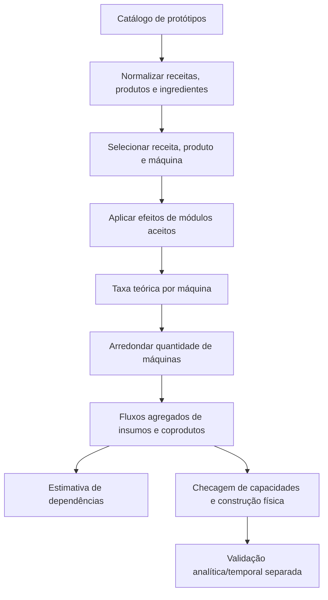

# Motor de produção

**Escopo:** cálculo determinístico de taxas, escolha de receitas e máquinas, dimensionamento de máquinas e estimativa de capacidades logísticas.  
**Fonte examinada:** código atual em `server.py`, `dependency_planner.py` e `production_math.py`.  
**Data da inspeção:** 2026-11-05.

## Estado e fronteiras

| Área | Estado no código | Limite da evidência |
|---|---|---|
| Normalização de receitas e produtos | Implementada | Usa os protótipos presentes no catálogo carregado. |
| Taxa teórica e arredondamento de máquinas | Implementados | Não provam que esteiras, inserters, energia ou oferta externa sustentem a taxa. |
| Escolha automática de receita para dependências | Heurística determinística | Ordena nomes e permite preferências explícitas; não resolve otimização global. |
| Planejamento de várias metas | Parcial/heurístico | Até 32 metas de itens; não é LP, não gera uma fábrica integrada conectada e não aceita metas de fluido. |
| Coprodutos | Ledger heurístico | A alocação depende da ordem de expansão; ciclos viram entradas externas. |
| Módulos de máquina | Implementados no fluxo de receita única | Efeitos de qualidade positiva são excluídos; beacons, pesquisa e qualidade não compõem o planejador conjunto. |
| Resultado operacional | Não comprovado pelo cálculo | A taxa base é teórica. A verificação física/temporal é uma etapa separada. |

O fluxo de uma única receita calcula a saída por máquina, arredonda a quantidade de máquinas para cima, calcula fluxos totais de ingredientes e produtos e depois chama a construção física. A análise de dependências é anexada para produtos de item, mas não transforma automaticamente toda a cadeia em uma fábrica conectada. [server.py — `_generate`](../../server.py#L1331), [server.py — plano e dependências](../../server.py#L1430).



## Catálogo numérico de receitas

`_expected_amount` converte um produto de protótipo em valor esperado: usa `amount` quando existe; caso contrário, usa o ponto médio entre `amount_min` e `amount_max`; por fim multiplica por `probability` (padrão 1). Produtos em formato de par `[nome, quantidade]` são tratados como itens. `_recipe_products` prefere `products`, depois `results`, e conserva o tipo do protótipo. Ingredientes também são normalizados para nome, tipo e quantidade. [server.py — `_expected_amount` e `_recipe_products`](../../server.py#L412), [server.py — `_recipe_ingredients`](../../server.py#L459).

Para um resultado com `amount_min=1`, `amount_max=3` e `probability=0,5`, a estimativa é `((1+3)/2) × 0,5 = 1` unidade por craft. Isso é média matemática; não modela a sequência aleatória de resultados numa janela curta.

## Escolha de máquinas e cálculo de taxa

`_machine_choices` inclui assembling machines, furnaces e rocket silos cuja lista `crafting_categories` intersecta a categoria da receita. A lista é ordenada por velocidade decrescente e nome decrescente; assim, a máquina padrão é a mais rápida da lista disponível no catálogo. A seleção enviada pelo usuário substitui essa escolha quando válida. Esse filtro é por categoria e protótipo, não uma prova de pesquisa desbloqueada no save. [server.py — `_machine_choices`](../../server.py#L495).

Para uma receita com duração-base `E` segundos, máquina de velocidade-base `S`, bônus total de velocidade `v`, quantidade esperada do produto `A`, bônus de produtividade `p` e parcela ignorada pela produtividade `I`, o caminho de receita única usa:

```text
S' = max(0,001, S × (1 + v))
A' = A + max(0, A - I) × p       se produtividade for permitida; caso contrário A' = A
crafts/min/máquina = S' × 60 / E
produto/min/máquina = A' × S' × 60 / E
máquinas = max(1, ceil(meta/min ÷ produto/min/máquina))
```

O código toma `E` com limite inferior de `0,001` segundo e `S'` com limite inferior de `0,001`. `I` vem de `ignored_by_productivity` do resultado original. O total instalado é a taxa teórica por máquina multiplicada pelo inteiro de máquinas; ingredientes usam ingredientes por craft multiplicados pelos crafts/min instalados. Produtos secundários também recebem taxa calculada, com produtividade permitida pelo mesmo protótipo. [server.py — `_generate`, efeitos e dimensionamento](../../server.py#L1331), [server.py — cálculo de taxas e plano](../../server.py#L1355).

**Exemplo ilustrativo, com hipóteses explícitas:** receita de 5 s, máquina com `S=0,5`, um produto/craft, sem produtividade e sem bônus de velocidade. Uma máquina faz `0,5 × 60 / 5 = 6 crafts/min`, portanto 6 itens/min. Meta de 200/min exige `ceil(200/6)=34` máquinas e capacidade teórica de 204/min. Se houver um ingrediente por craft, o plano calcula 204 unidades/min desse ingrediente. Isso ainda não confirma que o braço, a esteira e a entrada externa entreguem esse fluxo.

Com `p=0,2`, `I=0`, a mesma hipótese dá `A'=1,2`, 7,2 itens/min por máquina e `ceil(200/7,2)=28` máquinas; os ingredientes continuam acompanhando os crafts, não a produtividade adicional: 168 crafts/min para 28 máquinas. A folga é saída extra de produtividade.

### Regras de arredondamento e exceções

- O arredondamento é por máquina inteira, com um epsilon `1e-12` na contagem de crafts do planejador conjunto para evitar uma máquina extra por erro de ponto flutuante. [server.py — `_plan_integrated`](../../server.py#L1020).
- Para fundição automática em belt mode sem geometria manual, uma contagem ímpar é elevada ao próximo número par para manter linhas espelhadas equilibradas. [server.py](../../server.py#L1416).
- Para um padrão de metalurgia reconhecido em geometria automática, a meta também usa uma margem conservadora de 2% na taxa útil (`output_per_machine × 0,98`) antes de arredondar máquinas. [server.py](../../server.py#L1410).
- Esses acréscimos são exceções de geometria/transferência; não mudam a taxa teórica por máquina.

## Efeitos de módulos

`production_math.effects` valida compatibilidade por efeitos permitidos pela máquina, categorias aceitas, `allow_<efeito>` da receita, limitações e lista de bloqueio do módulo. Módulos com bônus positivo de qualidade são rejeitados porque o planejador conta produção normal e não distribui saídas por qualidade. Seleção manual não pode exceder os slots. O efeito total começa em `effect_receiver.base_effect` e soma os módulos escolhidos. [production_math.py — compatibilidade e efeitos](../../production_math.py#L5).

No modo automático, o código classifica cada módulo por uma soma ponderada. Pesos padrão: produtividade 2,5; velocidade 1; consumo −0,04; poluição −0,08; qualidade −5. Pesos fornecidos pelo usuário substituem os valores conhecidos se forem números finitos. O módulo de maior score positivo é repetido em todos os slots; não há busca combinatória por mistura de módulos. [production_math.py — seleção automática](../../production_math.py#L27).

O fluxo de receita única usa velocidade e produtividade para calcular produção. Também reporta `consumption_multiplier = max(0,2, 1 + bônus_consumo)`, mas esse campo não é um cálculo de watts consumidos. Para o padrão de metalurgia, se os itens produzidos excederem a capacidade estimada da esteira ou dos braços de saída, módulos automáticos são removidos e a taxa é recalculada. A opção de módulos é ignorada no plano conjunto, que força módulos vazios para manter o modelo de balanço consistente. [server.py](../../server.py#L1361), [server.py](../../server.py#L1387), [server.py — blocos integrados](../../server.py#L1118).

**Ausências confirmadas neste fluxo:** pesquisa/tecnologia não altera os cálculos; bônus de beacons não é selecionado nem aplicado; qualidade probabilística não é planejada; o plano conjunto declara esses fatores excluídos. [server.py — limitações do plano conjunto](../../server.py#L1067).

## Dependências, entradas e coprodutos

`plan_chain` é uma fachada de uma meta sobre `plan_targets`. O planejador filtra receitas ocultas, constrói um índice de produtores de itens e escolhe, para cada produto, a receita explicitamente preferida; sem preferência escolhe o nome de receita em ordem lexicográfica. Se houver alternativas, emite aviso. Itens declarados crus são entradas externas. Produtos sem receita também são contabilizados como entrada externa. Um ciclo recursivo é interrompido e a demanda do item no ciclo vira entrada externa com aviso. Fluidos de ingredientes são somados como demanda de fluido, sem expansão recursiva. [dependency_planner.py](../../dependency_planner.py#L10), [dependency_planner.py — índice e escolha](../../dependency_planner.py#L33), [dependency_planner.py — expansão](../../dependency_planner.py#L64).

Para atender demanda `R` de um produto com rendimento `Y` por craft, o algoritmo calcula `crafts/min = R/Y`. Soma a produção dos outros produtos da mesma receita a um inventário de coprodutos e tenta consumir esse inventário ao expandir dependências subsequentes. Os ingredientes são expandidos recursivamente. A ordem de metas afeta esse ledger; a própria função adiciona um aviso explícito em metas múltiplas. Não há programação linear, alocação global de produção ou prova de melhor combinação de receitas. O resultado marca `validated: false`. [dependency_planner.py — ledger e recursão](../../dependency_planner.py#L73), [dependency_planner.py — resultado e ressalva](../../dependency_planner.py#L139).

Em `_plan_integrated`, o usuário pode fornecer de 1 a 32 metas de item, cada uma apontando para receita e produto. Uma heurística inicial prefere a receita de menor custo unitário `energia / (velocidade_da_máquina × quantidade_do_produto)`; preferências explícitas substituem esse mapa. Minérios encontrados em `resource.minable` e subprodutos excluídos são tratados como externos. Por padrão, ferro e cobre em placas são excluídos como subprodutos externos, salvo configuração diferente. [server.py — setup do plano conjunto](../../server.py#L925), [server.py — recursos e entradas externas](../../server.py#L996), [server.py — lista de subprodutos](../../server.py#L445).

O planejador conjunto dimensiona máquinas por receita a partir dos crafts/min, arredonda para cima e recalcula os fluxos usando a capacidade arredondada. Em seguida compara, por item/tipo, produtos e ingredientes de todos os blocos com as metas; calcula entradas deficitárias e excedentes. Déficits de item que teoricamente têm produtor conhecido geram aviso para conectar entrada externa até a validação física. O plano termina como `layout_generated: false`; declara que o método é heurístico, não LP, não escolhe layout/roteamento e não inclui módulos, pesquisa, qualidade ou beacons. [server.py — dimensionamento e balanço global](../../server.py#L1020), [server.py — deficits, excedentes e limitações](../../server.py#L1042).

## Várias fábricas versus fábrica integrada

Há três caminhos distintos:

| Caminho | Comportamento | O que não significa |
|---|---|---|
| Lote (`_generate_batch`) | Executa até 32 objetivos independentes, registra falhas por objetivo e gera um Blueprint Book com os sucessos. | Não compartilha máquinas, materiais nem infraestrutura. |
| Plano conjunto integrado (`_generate_integrated`) | Expande várias metas item em receitas compartilhadas e produz um bloco por receita dentro de um livro. | Os blocos continuam independentes; conexões e roteamento entre blocos não são gerados. |
| Blueprint modular | Divide uma demanda grande de uma receita em blocos limitados e os agrupa em um livro. | A soma das capacidades não comprova throughput do livro nem infraestrutura comum. |

Lote e livro: [server.py](../../server.py#L898). Plano conjunto e blocos gerados: [server.py](../../server.py#L1074). O plano conjunto desabilita módulos em cada bloco e marca `blueprints_connected: false`; livro parcial pode ser retornado com falhas registradas por etapa. [server.py](../../server.py#L1111).

## Esteiras, inserters e limites da taxa

O orçamento nominal de esteira usa `total/min = speed × 28.800` e aplica margem configurável limitada a 0–30% para obter capacidade útil. A capacidade de cada faixa é metade do total. Para uma esteira com `speed=0,03125`, isso dá 900 itens/min teóricos no total, 450/faixa, antes da margem. [production_math.py](../../production_math.py#L86).

O orçamento de inserter é uma aproximação em ciclos: tamanho da mão `1 + bônus de stack do protótipo + bônus configurado`, tempo estimado de rotação e extensão da mão, quatro ticks adicionais e um fator de segurança limitado a 0,3–1,0. Taxa estimada: `3.600 × itens_por_mão / ticks_por_ciclo × segurança`. Não é uma medição do jogo. [production_math.py](../../production_math.py#L66).

`capacity_calculation` reporta a taxa teórica, número mínimo de máquinas pela receita, equipamento, orçamento de braços e taxas de interfaces. Sem análise física, o status começa como `NOT_SIMULATED`; com modelo, acrescenta limites derivados da análise rápida, incluindo alimentação, retirada por braços e esteiras. Buffer de inventário é explicitamente descrito como não aumentando a velocidade de produção. [production_math.py — relatório de capacidade](../../production_math.py#L92).

O planejador de layout por máquina verifica até quatro materiais de entrada em belt mode, agrupa ou divide materiais por esteira/faixa, calcula quantidade de braços de entrada/saída, compara demanda por máquina com as capacidades e limita máquinas por linha a 40, além do limite geométrico de largura. Se a demanda não cabe, rejeita o candidato ou recomenda outras configurações; não reduz silenciosamente a meta. [factory_planner.py — logística por máquina](../../factory_planner.py#L92), [factory_planner.py — limite de linha](../../factory_planner.py#L147).

## Limitações técnicas e riscos de interpretação

1. Taxa de receita é média esperada dos protótipos e capacidade de crafting; sozinha não valida o fornecimento de matérias-primas, a retirada de produtos, energia, fluidos ou bloqueios.
2. `dependency_analysis` calcula requisitos da cadeia, não instancia e conecta todas as etapas; `plan_targets` é recursivo e heurístico.
3. O plano integrado aceita metas de itens; cada receita recebe uma máquina padrão e o arredondamento para máquinas inteiras pode criar excedentes ou déficits globais.
4. Coprodutos probabilísticos são convertidos em quantidades esperadas, sem simular variância de curto prazo.
5. Módulos automáticos escolhem o mesmo melhor módulo para todos os slots por score linear; não avaliam combinações, beacons ou pesquisa.
6. A capacidade de braços usa um modelo conservador de ticks e fator de segurança; a validação operacional no jogo permanece separada.
7. Geração multi-meta em livro preserva blocos independentes e depende de alimentação externa e conexões manuais.

## Referências de código

- [server.py — normalização e máquina](../../server.py#L412), [escolha de máquina](../../server.py#L495), [geração de receita](../../server.py#L1331), [plano conjunto](../../server.py#L925), [módulos por bloco integrado](../../server.py#L1074), [lote e modularização](../../server.py#L898).
- [dependency_planner.py — expansão e coprodutos](../../dependency_planner.py#L10).
- [production_math.py — módulos, braços, esteiras e capacidade](../../production_math.py#L5).
- [factory_planner.py — limites de logística e escolha de geometria](../../factory_planner.py#L10).
