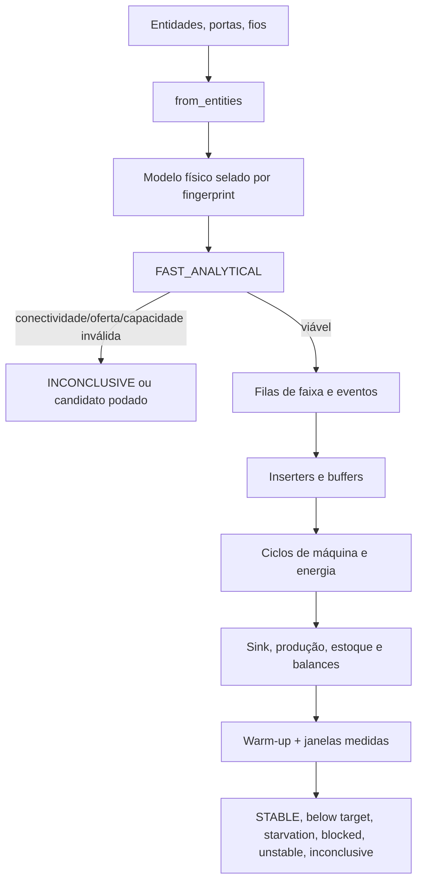

# Simulação temporal física

## Escopo e estado

O `temporal_simulation.py` atual é uma fachada pequena: converte/recupera o modelo físico e encaminha as chamadas. O simulador ativo está em `physical_simulation.py`, que aceita modelo selado derivado de entidades reais. Não é emulador da engine. [`_physical_model`, `fast_analytical`, `simulate_temporal`, `optimize_layout`](../../temporal_simulation.py#L70)

| Elemento | Estado | Delimitação |
|---|---|---|
| Modelo analítico `FAST_ANALYTICAL` | Implementado | Verifica conexões, caminhos, capacidade de inserter e oferta. Ainda depende de aproximações de velocidade e rota. |
| `TEMPORAL_SIMULATION` | Implementado e coberto por casos offline | Filas por lane, eventos de transporte, inserters, buffers, crafts, energia declarada, sinks, estabilidade e conservação. Operação in-game não verificada. |
| Fluidos, loaders, belt stacks, algumas prioridades/circuitos, qualidade estocástica e recirculação | Não suportados para simulação física completa | O modelo retorna `INCONCLUSIVE` quando presença de recurso não suportado impede avaliação. |
| Cache, limite de busca e cancelamento | Implementados no wrapper de otimização | Cache 32 entradas/32 MiB estimados; a memória do processo não é medida pelo limite do simulador. |

## Caminho de dados

`_physical_model` usa `layout.physical_model` se existir e valida sua impressão digital; se entidades forem passadas junto, devem ser idênticas. Sem modelo selado, precisa receber entities e portas e chama `from_entities`. Portanto, o simulador não aceita topologia abstrata como substituta da geometria. [`_physical_model`](../../temporal_simulation.py#L70)

## 1. Análise rápida

`source_contracts` transforma cada port input em taxa solicitada e taxa efetiva limitada pela capacidade. O padrão usa taxa ofertada pela porta; os modos de configuração podem usar oferta explícita, capacidade máxima ou margem. `external_suppliers` restringe faixa/capacidade, quantidade de belts e taxa oferecida. A taxa não nasce automaticamente como belt cheia. [`source_contracts`](../../physical_simulation.py#L55)

`_paths` percorre nós de belt por Dijkstra, acrescentando tempo `comprimento / velocidade` e estimativa de transferência para arestas de inserter filtradas por material. `fast_physical` associa arms às máquinas, compara a soma das capacidades de entrada/saída com a demanda por máquina, exige caminho de cada material fonte até máquina e de cada produto até sink, e compara o suprimento agregado com a demanda. Sua resposta traz `feasible`, `connectivity_valid`, erros, rotas, oferta, capacidade e maior viagem. [`_paths`](../../physical_simulation.py#L30), [`fast_physical`](../../physical_simulation.py#L86)

O modo analítico não rastreia fila temporal, sequência de itens, buffers em uso ou produção de cada ciclo. Ele elimina candidatos claramente inviáveis antes da simulação. `feasible` também exige ausência de `model.unsupported`; uma saída “conectada” não substitui validação temporal.

## 2. Estado e escala de tempo

`simulate_physical` usa filas `deque` por nó, contendo material, chegada e instante pronto. Um nó belt armazena capacidade derivada de comprimento (`floor(length × 4)` por default); contêineres usam capacidade fixa convertida de slots e stack size. O evento de movimento tem tempo de viagem por tile, e as gates limitam entrada/saída a intervalo mínimo de 0,25 tile relativo à velocidade. Isso é um modelo discreto de transporte com distância contínua simplificada. [`simulate_physical`](../../physical_simulation.py#L166)

| Parâmetro | Default/limite no código |
|---|---|
| `tick_seconds` | 1/60 s default; limitado a 0,1 s no máximo e 1/240 s no mínimo. |
| `measurement_window_seconds` | 60 s; mínimo efetivo 1 s. |
| `stability_windows` | 3 default; limitado a 2–8. |
| Warm-up | Maior viagem analítica + ciclo + duas janelas. Se há burners, considera enchimento de buffers com fator harmônico. Pode ser sobrescrito. |
| `max_simulation_seconds` | Até o menor entre horizonte calculado e default 900 s, ou 1.800 s se a máquina usa fuel burner. |
| `time_budget_seconds` | 20 s default, limitado por configuração da busca; checado aproximadamente a cada segundo simulado. |
| `memory_limit_mb` | 128 MiB default; é estimativa de model/eventos/items, não RSS. |
| Input/output buffers | Mínimo de um ciclo, dois ciclos default, configuráveis; entradas da máquina são limitadas por recipe ingredient amounts. |

Warm-up é excluído das taxas de produção e dos indicadores medidos, mas seus itens continuam no ledger de conservação. A estabilidade requer tanto taxa em janelas completas quanto estoque agregado pouco variável. [`simulate_physical`](../../physical_simulation.py#L166), [`simulate_physical` métricas/estabilidade](../../physical_simulation.py#L460)

## 3. Caminho de itens, belts e inserters

Fontes acumulam crédito fracionário conforme `actual_per_min / 60 × delta`; cada item inteiro é aceito no primeiro nó com espaço ou rejeitado, elevando `source_rejected`. Eventos movem a cabeça da fila após o tempo do segmento. Uma saída tenta primeiro sink com mesma matéria e slot de tempo disponível; depois tenta o próximo segmento. Se nenhum cabe, a fila permanece e tenta mais tarde: backpressure se propaga para trás.

Inserters decrementam transfer/cooldown de acordo com `power`. Arm com item na mão conclui o drop quando há destino disponível. Arm livre busca item elegível na lane/container, aplica filtro, verifica espaço do buffer, limita a coleta ao hand size e reserva espaço da máquina antes do drop. O objeto de mão mantém os itens enquanto transita. A simulação usa vetores de pickup/drop ajustados ao endpoint físico real para recalcular o ciclo. [`simulate_physical`](../../physical_simulation.py#L285), [`_arm_estimate`](../../physical_simulation.py#L20)

Splitters com mais de um alvo alternam as saídas em round-robin quando não há `output_priority`; o código escolhe um alvo que tenha espaço. Belt underground é um nó cuja viagem usa distância entre entrada e saída. Isso não modela a lógica integral de splitter, side-loading, prioridade de entrada, loaders ou itens com stack belt. O produtor de topo físico pode marcar essas features como `unsupported`. [`simulate_physical`](../../physical_simulation.py#L285), [`from_entities`](../../physical_factory.py#L81)

## 4. Máquinas, crafts, WIP e energia

A máquina simula ciclo `energy_required / machine_speed`, com `machine_speed_factors` por índice. No início do ciclo, exige `amount` inteiro para cada ingrediente e move os itens para `wip`; no término, contabiliza consumo, incrementa crafts completos e emite produtos. Rendimentos fracionários ficam em `yield_credit` até completar um item inteiro. O buffer de saída cheio gera `OUTPUT_BLOCKED`; falta de ingrediente, `WAITING_FOR_INGREDIENTS`.

O simulador exige ingredientes de item por craft positivos e inteiros. Isso preserva contagem unitária do modelo. Produtos de receita podem usar `effective_amount`; produtos fracionários se conservam por crédito. Receitas estocásticas e efeitos de qualidade são explicitamente marcados como não suportados no `from_entities`.

Energia elétrica é uma hipótese externa: `power_fraction`, `power_schedule`, `available_power_kw` e `machine_power_schedule` alteram o tempo efetivo do ciclo e dos braços. `model.power.required_kw` soma energia das máquinas elétricas; não inclui o consumo de arms no orçamento de potência nem modela produção ou distribuição detalhada da rede. Não há simulação da geração da usina. Burners de máquina têm um caso limitado: um combustível, sem burnt result, energia em buffer e uso em joules; warm-up inclui cálculo específico. Burners em inserters e outras combinações são não suportados. [`from_entities`](../../physical_factory.py#L241), [`simulate_physical`](../../physical_simulation.py#L166), [`simulate_physical` ciclos/fuel](../../physical_simulation.py#L385)

## 5. Estabilidade, starvation e conservação

Cada janela medida soma itens produzidos para o produto solicitado. A taxa sustentada é `itens da janela × 60 / segundos da janela`; a taxa média é média de janelas completas. `production_stable` compara amplitude máxima/mínima entre janelas com `max(1 item/min, 5% da produção teórica)`. `inventory_stable` compara estoques agregados entre janelas com `max(2 itens, 2% da capacidade agregada estimada)`. A produção precisa completar todas as janelas para ser considerada estável. [`simulate_physical` estabilidade](../../physical_simulation.py#L460)

O saldo dos insumos inclui fonte aceita e estoque inicial; subtrai consumo finalizado e registra ingredientes em WIP, belt, container, mãos de inserter e inventário da máquina. O saldo de produto compara produção a exportação e estoques remanescentes; `transformation_error` confere crafts completos × yield contra produto inteiro e crédito fracionário. Fuel mantém balanço separado de joules carregados, consumidos e restantes. `conservation.valid` exige erro numérico dentro da tolerância usada. [`simulate_physical` ledgers](../../physical_simulation.py#L480)

Starvation é soma dos segundos-máquina em espera por ingredientes ou combustível; bloqueio é segundos-máquina em `OUTPUT_BLOCKED`. Saídas também incluem uso, estado, estoques min/média/máx, itens recebidos/consumidos/produzidos, métricas por lane, segmento, fonte e recuperação após interrupções.

Estados terminais principais:

| Estado | Significado do código |
|---|---|
| `CANCELLED` | Cancelamento cooperativo observado. |
| `INCONCLUSIVE` | Budget, memória estimada ou conservação falharam; ou modelo/prototype não permite construir simulação. |
| `UNSTABLE` | Janela insuficiente ou taxa/estoque não convergiram. |
| `OUTPUT_BLOCKED` | Bloqueio persistente impede atingir a meta. |
| `STARVATION_SUSTAINED` | Faltam ingredientes/fuel na medição e meta não é atingida. |
| `STABLE` | Produção e inventário estáveis, conservação válida e meta atingida. |
| `STABLE_BELOW_TARGET` | Estável, mas abaixo da meta. |

## 6. Busca, cache e seleção

`temporal_simulation.optimize_layout` delega a `physical_optimization.optimize_factory`. A busca gera candidatos/topologias, remove os que falham em conectividade/capacidade/serialização/limites, executa a simulação temporal e calcula score de perfil. Só candidato `STABLE`, com meta atingida e conservação válida entra na lista de viáveis. Se não houver um assim, o código pode devolver prévia física exportável com `selected_is_validated=false`; isso é diagnóstico, não uma validação temporal. [`optimize_factory`](../../physical_optimization.py#L121)

O cache LRU tem limite de 32 entradas e 32 MiB calculados a partir do tamanho textual do resultado. A chave inclui hash do modelo e configuração, exceto budgets de tempo/search. `CANCELLED` e `INCONCLUSIVE` não são armazenados. O lock é reentrante e as entradas retornam por deep copy. Busca limita candidatos por `temporal_candidate_limit` (default 6, máximo 12) e orçamento global (default 45 s, máximo 180 s); cancelamento e progresso são cooperativos. [`clear_cache`, `evaluate`](../../physical_optimization.py#L16), [`optimize_factory`](../../physical_optimization.py#L121)

## 7. Evidência histórica offline

O relatório de 25/10/2026 descreve execução sobre prototypes locais e registra cenário de Ciência Vermelha: 23 máquinas, 207/min teóricos, alvo 200/min, seis candidatos físicos, taxa simulada 207/min nos candidatos, conservação válida e linear escolhido. `comparison.json` informa busca completa com 6 avaliações em 11,407857 s, budget de 45 s e `selected_is_validated=true`. `cache.json` registra hit de 33,2566 ms; `convergence.json` documenta passos 1/30, 1/60 e 1/120 s estáveis a 207/min. O documento apresenta pico estimado por candidato entre 0,36–0,40 MiB. São amostras locais; não são mediana/benchmark controlado nem teste no jogo. [Relatório histórico](../blueprint-quality/PHYSICAL-TEMPORAL-OPTIMIZATION.md#L90), [comparação](../../outputs/physical-temporal/red-science/comparison.json), [cache](../../outputs/physical-temporal/red-science/cache.json), [convergência](../../outputs/physical-temporal/red-science/convergence.json)

Os artefatos não registram versão do Factorio ou hash do dump. A execução do runner lê um dump já existente e não inicia o jogo; a data do relatório não comprova a versão exata. [`run_physical_cases.py`](../blueprint-quality/cases/run_physical_cases.py#L1)

Os relatórios históricos também registram 82 testes offline e build WPF sem avisos/erros em 25/10, além dos casos que cobrem conservação, WIP, interrupções, topologias, rotação, buffers, cache e cancelamento. Essa suíte não foi reproduzida nesta tarefa e nenhum teste operacional foi executado no Factorio. [Registro da suíte](../blueprint-quality/PHYSICAL-TEMPORAL-OPTIMIZATION.md#L126)

## 8. Limitações e próximos critérios de aceitação

- Não há comparação sistemática do resultado offline com ticks reais de Factorio para os mesmos prototypes, save, superfície, circuitos e inventários externos.
- Movimento de item e inserter, side-loading, splitter e underground usam discretização/aproximações. O status estável só vale dentro desse modelo.
- Fluidos e robôs logísticos não participam do simulador temporal. `FAST_ANALYTICAL` não pode transformá-los em prova operacional.
- `memory_limit_mb` é estimativa; não é limite de RSS. Budget e amostragem podem terminar como `INCONCLUSIVE`/`UNSTABLE`.
- Inteiros em contagem de ingrediente são requisito do modelo de item; receitas fluidas, probabilísticas, qualidade e recirculação requerem modelos separados ou explicitamente suportados.
- Para declarar validade operacional, é preciso importar e executar as blueprints em jogo controlado, comparar throughput/estados e conservar artefatos de teste com versão e fingerprint do dump. Isso é critério futuro, não ação tomada aqui.

## Referências

- [`temporal_simulation.py`](../../temporal_simulation.py): integração e estimador de inserter.
- [`physical_simulation.py`](../../physical_simulation.py): análise rápida, eventos, máquinas e ledgers.
- [`physical_factory.py`](../../physical_factory.py): grafo, portas e classificação de suporte.
- [`physical_optimization.py`](../../physical_optimization.py): busca, cache e seleção.
- [`blueprint_quality.py`](../../blueprint_quality.py): validações estáticas de geometria/serialização.
